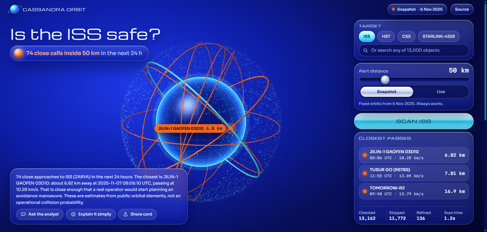
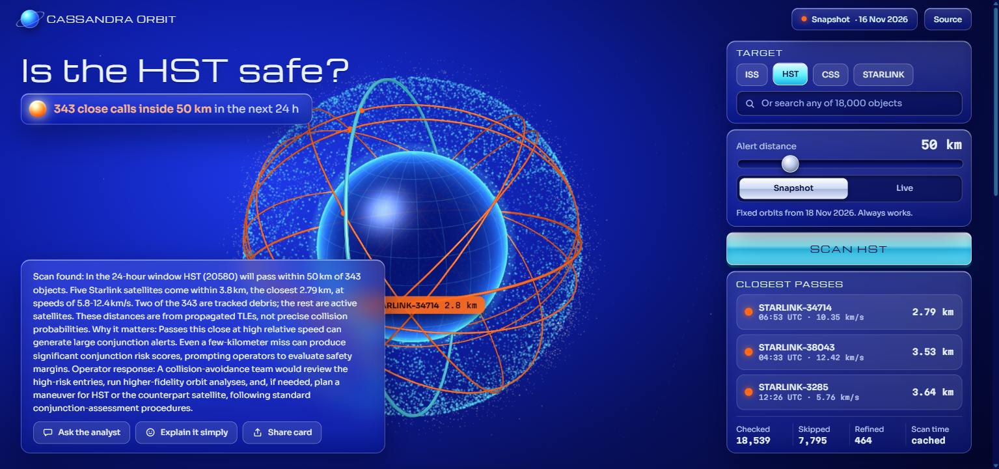
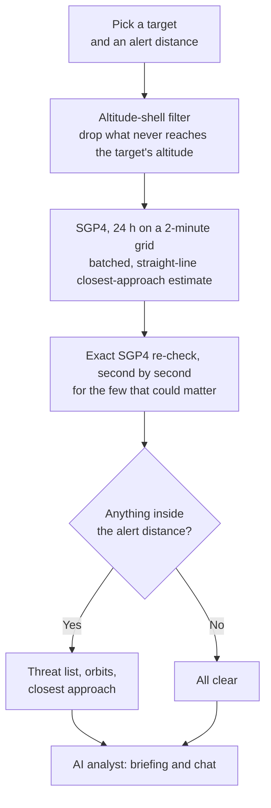
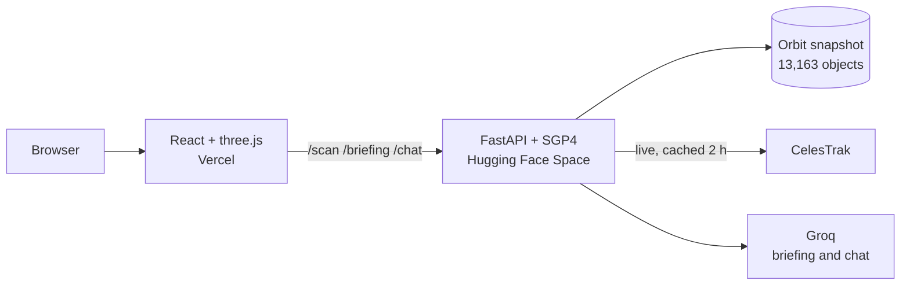
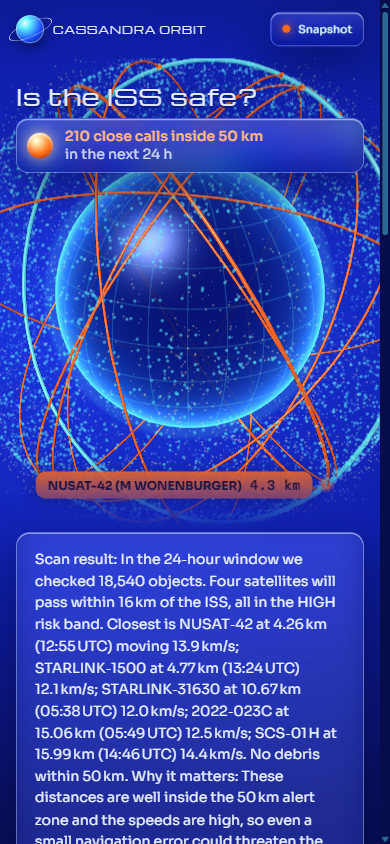

<p align="center">
  
</p>

<p align="center">
  <b>Live demo</b> (link added once deployed)
  &nbsp;·&nbsp;
  <a href="#how-it-works">How it works</a>
  &nbsp;·&nbsp;
  <a href="#run-it-yourself">Run it yourself</a>
</p>

<p align="center">
  
  
  
  
  
</p>

Pick a satellite, hit **Scan**, and find out whether anything in orbit gets close to it in the next 24 hours. Cassandra Orbit checks 18,000+ tracked objects (working satellites plus 2,600+ pieces of known debris) against the ISS, Hubble, the Tiangong station, a Starlink, or anything you search for, then shows the close passes on a 3D globe and explains them in plain language.

> This is a screening demo built on public orbital elements. The distances are estimates, **not** an operational collision probability, and real operators use far more precise data.

## Features

<p align="center">
  
</p>

* **A real physics scan.** Every object is flown forward 24 hours with SGP4, the standard orbit model, and the target is compared against all of them.
* **Fast enough to feel live.** Objects that can never reach the target's altitude are dropped first, the rest are propagated in batches, and only the close ones are re-checked second by second. The ISS scan takes a few seconds instead of the original 17.
* **Fast crossings are not missed.** Two objects meeting head-on close at 10 to 14 km/s, so a one-minute sampling grid can skip over the closest point. The re-check finds it (the closest ISS pass in the bundled snapshot is 6.8 km at 10.3 km/s).
* **Snapshot or live orbits.** A bundled snapshot of 13,163 objects always works; the Live switch pulls today's orbits from CelesTrak (cached for two hours, as CelesTrak asks).
* **A 3D view you can drag and poke.** The whole catalogue as a point cloud, the target's orbit and every threat's full orbit as a closed ring. Hover an orbit to see who it is, tap or click it to pin it (the pass list and table do the same).
* **An AI analyst.** A plain-language briefing for every scan, an "explain it simply" mode, and a chat that only knows that scan. It sees the numbers, nothing else.
* **A shareable close-call card.** One tap turns the scan into a 4:5 image.

## How it works



The deployed system:



The first screen opens with a precomputed ISS scan bundled in `public/demo.json`, so the page is alive before the API wakes. The API exposes `/health`, `/targets`, `/objects` (search), `/cloud`, `/scan`, `/briefing` and `/chat`.

### A note on orbit data

TLEs go stale within days. The snapshot is fixed, so a scan on it starts from the snapshot's own date, not from today, and says so on screen. Use **Live** for today's orbits.

## Tech stack

| | |
|---|---|
| **Frontend** | React 18, TypeScript, Vite, three.js. Fonts: Michroma, Sora, Martian Mono (self-hosted). |
| **Backend** | FastAPI, NumPy, [`sgp4`](https://pypi.org/project/sgp4/) (vectorised `SatrecArray`), httpx. |
| **AI** | Groq (`openai/gpt-oss-120b`) through its REST API. A rule-based briefing is used when there is no key. |
| **Data** | [CelesTrak](https://celestrak.org) `active` group plus the Cosmos 2251, Iridium 33, Fengyun-1C and Cosmos 1408 debris groups, with a bundled snapshot in `backend/data/active.txt` and `backend/data/debris.txt`. Debris points are warm white on the globe and diamond-shaped on the timeline. |

### On a phone

<p align="center">
  
</p>

<a id="run-it-yourself"></a>

## Run it yourself

```bash
git clone https://github.com/aristotile-dev/Space-Debris-Alert-Dashboard.git
cd Space-Debris-Alert-Dashboard
```

**Backend** (Python 3.11):

```bash
cd backend
pip install -r requirements.txt
# optional, for the AI analyst: set GROQ_API_KEY in your environment
uvicorn api:app --port 7861
```

**Frontend:**

```bash
npm install
echo "VITE_API_BASE_URL=http://localhost:7861" > .env.local
npm run dev
```

Rebuild the bundled first-screen data after changing the snapshot or the scan:

```bash
cd backend && python make_demo.py
```

## Project layout

```
Space-Debris-Alert-Dashboard
├── src/
│   ├── App.tsx        console: controls, status, briefing, table, chat drawer
│   ├── Globe.tsx      three.js scene: glass Earth, debris cloud, orbit tubes
│   ├── card.ts        the shareable close-call card (canvas to PNG)
│   ├── api.ts         typed API client
│   └── styles.css     the Y2K chrome-future design tokens and components
├── backend/
│   ├── core.py        catalogue, altitude filter, SGP4 scan, live cache
│   ├── api.py         FastAPI routes and rate limits
│   ├── llm.py         briefing and chat (Groq), rule-based fallback
│   ├── make_demo.py   writes public/demo.json
│   └── data/             orbit snapshots (active.txt, debris.txt)
├── public/demo.json   precomputed first screen
└── assets/            README screenshots
```

## Acknowledgements

Orbit data and years of public TLE service from Dr. T.S. Kelso and [CelesTrak](https://celestrak.org).

## License

MIT. See [LICENSE](LICENSE).
