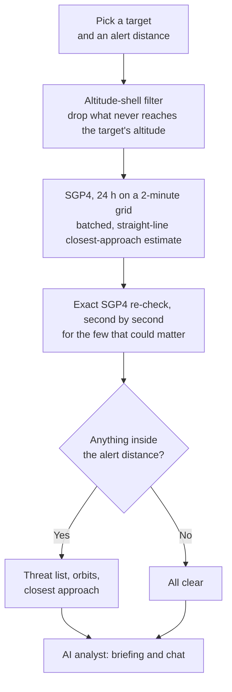
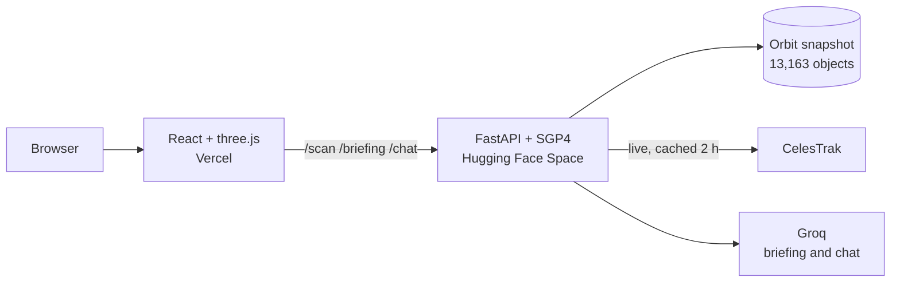

<!-- Automatically generated from README.md by .github/workflows/translate-readme.yml. Do not edit by hand. -->
<p align="center"><sub><a href="../../README.md">English</a> · <a href="README.ta.md">தமிழ்</a> · <a href="README.hi.md">हिन्दी</a> · <a href="README.te.md">తెలుగు</a> · <a href="README.ml.md">മലയാളം</a> · <a href="README.kn.md">ಕನ್ನಡ</a> · <a href="README.bn.md">বাংলা</a> · <a href="README.es.md">Español</a> · <a href="README.fr.md">Français</a> · <a href="README.de.md">Deutsch</a> · <a href="README.pt-BR.md">Português</a> · <a href="README.ja.md">日本語</a> · <a href="README.zh-CN.md">简体中文</a> · <b>العربية</b></sub></p>

<p align="center">
  
</p>

<p align="center">
  <a href="https://cassandra-orbit.vercel.app"><b>العرض الحي</b></a>
  &nbsp;·&nbsp;
  <a href="#how-it-works">كيف يعمل</a>
  &nbsp;·&nbsp;
  <a href="#run-it-yourself">تشغيله بنفسك</a>
</p>

<p align="center">
  
  
  
  
  
</p>


اختر قمرًا صناعيًا، اضغط **Scan**، واكتشف ما إذا كان أي شيء في المدار يقترب منه خلال الـ 24 ساعة القادمة. يقوم Cassandra Orbit بفحص أكثر من 18,000 جسم مُتتبَع (الأقمار العاملة بالإضافة إلى أكثر من 2,600 قطعة من الحطام المعروف) مقابل ISS، Hubble، محطة Tiangong، Starlink أو أي شيء تبحث عنه، ثم يعرض الاقترابات القريبة على كرة أرضية ثلاثية الأبعاد ويشرحها بلغة بسيطة.

> هذا عرض توضيحي للفحص مبني على عناصر مدارية عامة. المسافات هي تقديرات، **ليست** احتمالية تصادم تشغيلية، وتستخدم الجهات المشغلة بيانات أكثر دقة بكثير.

## Features

<p align="center">
  
</p>

* **مسح فيزيائي حقيقي.** يتم دفع كل جسم إلى الأمام لمدة 24 ساعة باستخدام SGP4، نموذج المدار القياسي، ويتم مقارنة الهدف مع جميعها.
* **سرعة كافية لتشعر بأنه مباشر.** تُستبعد أولاً الأجسام التي لا يمكنها الوصول إلى ارتفاع الهدف، ثم تُنشر البقية على دفعات، وتُعاد فحص القريبة منها ثانيةً ثانيةً. يستغرق فحص ISS بضع ثوانٍ بدلاً من 17 ثانية الأصلية.
* **لا تُفوت التقاطعات السريعة.** يلتقي جسمان رأسًا على عقب بسرعة 10 إلى 14 كم/ث، لذا قد يتخطى شبكة أخذ العينات الدقيقة الدقيقة نقطة الاقتراب الأقرب. يعيد الفحص اكتشافها (أقرب مرور للـ ISS في اللقطة المجمعة هو 6.8 كم بسرعة 10.3 كم/ث).
* **لقطات ثابتة أو مدارات مباشرة.** لقطة مجمعة لأكثر من 18,000 جسم (أقمار صناعية بالإضافة إلى الحطام المعروف)، تُحدَّث يوميًا عبر إجراء GitHub Action، وتعمل دائمًا؛ زر Live يجلب مدارات اليوم من CelesTrak (مخزنة مؤقتًا لمدة ساعتين، حسب طلب CelesTrak).
* **عرض ثلاثي الأبعاد يمكنك سحبه والنقر عليه.** الكتالوج كاملًا كسحابة نقطية، مدار الهدف وكل تهديد كحلقة مغلقة. مرّر فوق مدار لتعرف ما هو، اضغط أو انقر لتثبيته (قائمة المرور والجدول يفعّلان نفس الوظيفة).
* **محلل ذكاء اصطناعي.** ملخص بلغة بسيطة لكل فحص، وضع "اشرحها ببساطة"، ودردشة تعرف فقط هذا الفحص. يرى الأرقام ولا شيء غيرها.
* **بطاقة مشاركة للاتصال القريب.** نقرة واحدة تحول الفحص إلى صورة بنسبة 4:5.

## How it works



النظام المنشور:



تفتح الشاشة الأولى بفحص ISS مسبق الحساب مضمّن في `public/demo.json`، لذا تكون الصفحة نشطة قبل أن يستيقظ الـ API. يوفّر الـ API النقاط `/health`، `/targets`، `/objects` (بحث)، `/cloud`، `/scan`، `/briefing` و`/chat`.

### ملاحظة حول بيانات المدار

تصبح ملفات TLE قديمة خلال أيام. تُحدَّث اللقطة يوميًا، لكن الفحص عليها لا يزال يبدأ من تاريخ اللقطة نفسها، وليس من اليوم، ويُظهر ذلك على الشاشة. استخدم **Live** للحصول على مدارات اليوم.

## Tech stack

| | |
|---|---|
| **Frontend** | React 18، TypeScript، Vite، three.js. الخطوط: Michroma، Sora، Martian Mono (مستضافة ذاتيًا). |
| **Backend** | FastAPI، NumPy، [`sgp4`](https://pypi.org/project/sgp4/) (`SatrecArray` متجهة)، httpx. |
| **AI** | Groq (`openai/gpt-oss-120b`) عبر واجهة REST الخاصة به. يُستَخدم ملخص قائم على القواعد عندما لا يتوفر مفتاح. |
| **Data** | مجموعة `active` من [CelesTrak](https://celestrak.org) بالإضافة إلى مجموعات الحطام Cosmos 2251، Iridium 33، Fengyun-1C وCosmos 1408، مع لقطة مجمعة في `backend/data/active.txt` و`backend/data/debris.txt`. تُظهر نقاط الحطام باللون الأبيض الدافئ على الكرة الأرضية وبشكل ماسي على الخط الزمني. |

## Run it yourself

```bash
git clone https://github.com/aristotile-dev/Space-Debris-Alert-Dashboard.git
cd Space-Debris-Alert-Dashboard
```

**Backend** (Python 3.11):

```bash
cd backend
pip install -r requirements.txt
# optional, for the AI analyst: set GROQ_API_KEY in your environment
uvicorn api:app --port 7861
```

**Frontend:**

```bash
npm install
echo "VITE_API_BASE_URL=http://localhost:7861" > .env.local
npm run dev
```

أعد بناء بيانات الشاشة الأولى المجمعة بعد تعديل اللقطة أو الفحص:

```bash
cd backend && python make_demo.py
```

## Project layout

```
Space-Debris-Alert-Dashboard
├── src/
│   ├── App.tsx        console: controls, status, briefing, table, chat drawer
│   ├── Globe.tsx      three.js scene: glass Earth, debris cloud, orbit tubes
│   ├── card.ts        the shareable close-call card (canvas to PNG)
│   ├── api.ts         typed API client
│   └── styles.css     the Y2K chrome-future design tokens and components
├── backend/
│   ├── core.py        catalogue, altitude filter, SGP4 scan, live cache
│   ├── api.py         FastAPI routes and rate limits
│   ├── llm.py         briefing and chat (Groq), rule-based fallback
│   ├── make_demo.py   writes public/demo.json
│   └── data/             orbit snapshots (active.txt, debris.txt)
├── public/demo.json   precomputed first screen
└── assets/            README screenshots
```

## Acknowledgements

بيانات المدار وسنوات خدمة TLE العامة من الدكتور T.S. Kelso و[CelesTrak](https://celestrak.org).

## License

MIT. راجع [LICENSE](../../LICENSE).
