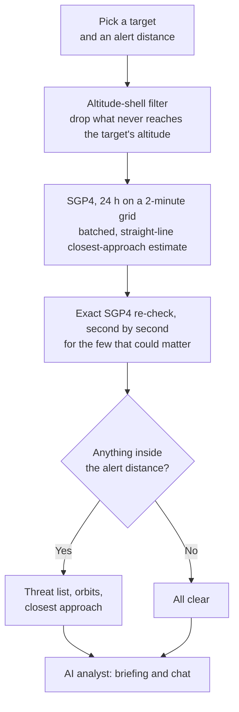
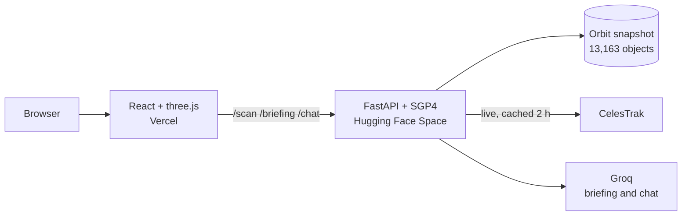

<!-- Automatically generated from README.md by .github/workflows/translate-readme.yml. Do not edit by hand. -->
<p align="center"><sub><a href="../../README.md">English</a> · <a href="README.ta.md">தமிழ்</a> · <a href="README.hi.md">हिन्दी</a> · <a href="README.te.md">తెలుగు</a> · <a href="README.ml.md">മലയാളം</a> · <a href="README.kn.md">ಕನ್ನಡ</a> · <b>বাংলা</b> · <a href="README.es.md">Español</a> · <a href="README.fr.md">Français</a> · <a href="README.de.md">Deutsch</a> · <a href="README.pt-BR.md">Português</a> · <a href="README.ja.md">日本語</a> · <a href="README.zh-CN.md">简体中文</a> · <a href="README.ar.md">العربية</a></sub></p>

<p align="center">
  
</p>

<p align="center">
  <a href="https://cassandra-orbit.vercel.app"><b>Live demo</b></a>
  &nbsp;·&nbsp;
  <a href="#how-it-works">How it works</a>
  &nbsp;·&nbsp;
  <a href="#run-it-yourself">Run it yourself</a>
</p>

<p align="center">
  
  
  
  
  
</p>


একটি স্যাটেলাইট নির্বাচন করুন, **Scan** চাপুন, এবং পরবর্তী ২৪ ঘন্টার মধ্যে তার কক্ষপথে কোনো বস্তু কাছাকাছি আসে কিনা জানুন। Cassandra Orbit ১৮,০০০+ ট্র্যাক করা বস্তু (কাজ করা স্যাটেলাইট এবং ২,৬০০+ পরিচিত ধ্বংসাবশেষ) কে ISS, Hubble, Tiangong স্টেশন, একটি Starlink অথবা আপনার অনুসন্ধানকৃত যেকোনো বস্তুর সঙ্গে তুলনা করে, তারপর ৩ডি গ্লোবে কাছাকাছি পারাপারগুলো দেখায় এবং সেগুলোকে সরল ভাষায় ব্যাখ্যা করে।

> এটি একটি স্ক্রিনিং ডেমো যা পাবলিক কক্ষপথ উপাদানের উপর ভিত্তি করে তৈরি। দূরত্বগুলো আনুমানিক, **অপারেশনাল সংঘর্ষ সম্ভাবনা নয়**, এবং বাস্তব অপারেটররা আরও সুনির্দিষ্ট ডেটা ব্যবহার করেন।

## Features

<p align="center">
  
</p>

* **একটি বাস্তব পদার্থবিজ্ঞানের স্ক্যান।** প্রতিটি বস্তুকে SGP4, মানক কক্ষপথ মডেল ব্যবহার করে ২৪ ঘন্টা অগ্রসর করা হয়, এবং লক্ষ্যকে সবগুলোর সঙ্গে তুলনা করা হয়।
* **লাইভের মতো দ্রুত।** লক্ষ্য উচ্চতায় কখনো পৌঁছাতে পারে না এমন বস্তুগুলো প্রথমে বাদ দেওয়া হয়, বাকি গুলো ব্যাচে প্রোপাগেট করা হয়, এবং শুধুমাত্র কাছাকাছি বস্তুগুলো সেকেন্ডে সেকেন্ডে পুনরায় পরীক্ষা করা হয়। ISS স্ক্যানটি মূল ১৭ সেকেন্ডের পরিবর্তে কয়েক সেকেন্ডে সম্পন্ন হয়।
* **দ্রুত পারাপারগুলো মিস হয় না।** দুইটি বস্তু মুখোমুখি হয়ে ১০ থেকে ১৪ কিমি/সেকেন্ডে কাছাকাছি হয়, তাই এক মিনিটের স্যাম্পলিং গ্রিড সবচেয়ে কাছের পয়েন্টটি এড়িয়ে যেতে পারে। পুনরায় পরীক্ষা করে তা পাওয়া যায় (বাণ্ডলড স্ন্যাপশটে সবচেয়ে কাছের ISS পারাপার ৬.৮ কিমি দূরত্বে ১০.৩ কিমি/সেকেন্ড)।
* **স্ন্যাপশট অথবা লাইভ কক্ষপথ।** ১৮,০০০+ বস্তু (স্যাটেলাইট এবং পরিচিত ধ্বংসাবশেষ) নিয়ে একটি বাণ্ডলড স্ন্যাপশট, যা প্রতিদিন একটি GitHub Action দ্বারা রিফ্রেশ হয়; লাইভ সুইচটি CelesTrak থেকে আজকের কক্ষপথ টানে (দুটি ঘন্টার জন্য ক্যাশ করা থাকে, CelesTrak এর অনুরোধ অনুযায়ী)।
* **একটি ৩ডি ভিউ যা আপনি ড্র্যাগ ও পোক করতে পারেন।** পুরো ক্যাটালগ একটি পয়েন্ট ক্লাউড হিসেবে, লক্ষ্য কক্ষপথ এবং প্রতিটি হুমকির পূর্ণ কক্ষপথ একটি বন্ধ রিং হিসেবে। কোনো কক্ষপথে হোভার করলে তার পরিচয় দেখা যায়, ট্যাপ বা ক্লিক করলে তা পিন হয় (পাস লিস্ট এবং টেবিলও একই কাজ করে)।
* **একটি AI বিশ্লেষক।** প্রতিটি স্ক্যানের জন্য সরল-ভাষার ব্রিফিং, "সহজে ব্যাখ্যা করুন" মোড, এবং একটি চ্যাট যা শুধুমাত্র সেই স্ক্যানকে জানে। এটি সংখ্যা দেখে, আর কিছু নয়।
* **একটি শেয়ারযোগ্য ক্লোজ-কল কার্ড।** এক ট্যাপেই স্ক্যানকে ৪:৫ অনুপাতে একটি ছবিতে রূপান্তর করে।

## How it works



The deployed system:



প্রথম স্ক্রিনটি `public/demo.json`-এ পূর্বগণিত ISS স্ক্যানের সঙ্গে খোলে, তাই API জাগ্রত হওয়ার আগে পেজটি সক্রিয় থাকে। API `/health`, `/targets`, `/objects` (search), `/cloud`, `/scan`, `/briefing` এবং `/chat` এন্ডপয়েন্টগুলো প্রকাশ করে।

### A note on orbit data

TLE গুলো কয়েক দিনের মধ্যে পুরনো হয়ে যায়। স্ন্যাপশটটি দৈনিক রিফ্রেশ হয়, তবে তাতে স্ক্যান করা হলে এখনও স্ন্যাপশটের তারিখ থেকে শুরু হয়, আজকের নয়, এবং স্ক্রিনে তা উল্লেখ করা হয়। আজকের কক্ষপথের জন্য **Live** ব্যবহার করুন।

## Tech stack

| | |
|---|---|
| **Frontend** | React 18, TypeScript, Vite, three.js. Fonts: Michroma, Sora, Martian Mono (self-hosted). |
| **Backend** | FastAPI, NumPy, [`sgp4`](https://pypi.org/project/sgp4/) (vectorised `SatrecArray`), httpx. |
| **AI** | Groq (`openai/gpt-oss-120b`) through its REST API. A rule-based briefing is used when there is no key. |
| **Data** | [CelesTrak](https://celestrak.org) `active` group plus the Cosmos 2251, Iridium 33, Fengyun-1C and Cosmos 1408 debris groups, with a bundled snapshot in `backend/data/active.txt` and `backend/data/debris.txt`. Debris points are warm white on the globe and diamond-shaped on the timeline. |

## Run it yourself

```bash
git clone https://github.com/aristotile-dev/Space-Debris-Alert-Dashboard.git
cd Space-Debris-Alert-Dashboard
```

**Backend** (Python 3.11):

```bash
cd backend
pip install -r requirements.txt
# optional, for the AI analyst: set GROQ_API_KEY in your environment
uvicorn api:app --port 7861
```

**Frontend:**

```bash
npm install
echo "VITE_API_BASE_URL=http://localhost:7861" > .env.local
npm run dev
```

স্ন্যাপশট বা স্ক্যান পরিবর্তন করার পরে বাণ্ডলড প্রথম-স্ক্রিন ডেটা পুনর্নির্মাণ করুন:

```bash
cd backend && python make_demo.py
```

## Project layout

```
Space-Debris-Alert-Dashboard
├── src/
│   ├── App.tsx        console: controls, status, briefing, table, chat drawer
│   ├── Globe.tsx      three.js scene: glass Earth, debris cloud, orbit tubes
│   ├── card.ts        the shareable close-call card (canvas to PNG)
│   ├── api.ts         typed API client
│   └── styles.css     the Y2K chrome-future design tokens and components
├── backend/
│   ├── core.py        catalogue, altitude filter, SGP4 scan, live cache
│   ├── api.py         FastAPI routes and rate limits
│   ├── llm.py         briefing and chat (Groq), rule-based fallback
│   ├── make_demo.py   writes public/demo.json
│   └── data/             orbit snapshots (active.txt, debris.txt)
├── public/demo.json   precomputed first screen
└── assets/            README screenshots
```

## Acknowledgements

Orbit data and years of public TLE service from Dr. T.S. Kelso and [CelesTrak](https://celestrak.org)।

## License

MIT. See [LICENSE](../../LICENSE)।
