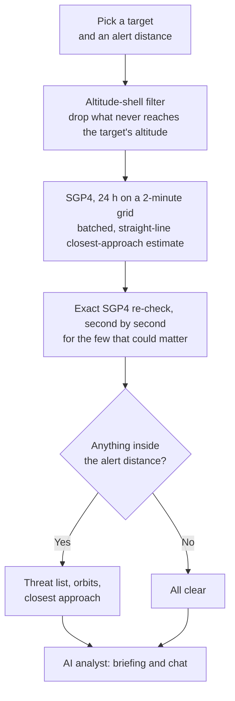
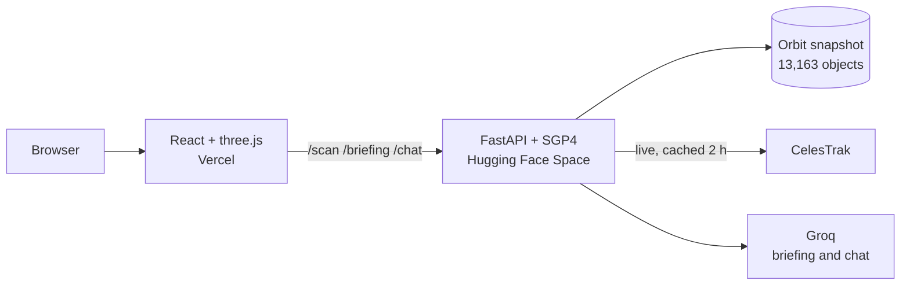

<!-- Automatically generated from README.md by .github/workflows/translate-readme.yml. Do not edit by hand. -->
<p align="center"><sub><a href="../../README.md">English</a> · <a href="README.ta.md">தமிழ்</a> · <a href="README.hi.md">हिन्दी</a> · <a href="README.te.md">తెలుగు</a> · <a href="README.ml.md">മലയാളം</a> · <a href="README.kn.md">ಕನ್ನಡ</a> · <a href="README.bn.md">বাংলা</a> · <a href="README.es.md">Español</a> · <a href="README.fr.md">Français</a> · <b>Deutsch</b> · <a href="README.pt-BR.md">Português</a> · <a href="README.ja.md">日本語</a> · <a href="README.zh-CN.md">简体中文</a> · <a href="README.ar.md">العربية</a></sub></p>

<p align="center">
  
</p>

<p align="center">
  <a href="https://cassandra-orbit.vercel.app"><b>Live demo</b></a>
  &nbsp;·&nbsp;
  <a href="#how-it-works">Wie es funktioniert</a>
  &nbsp;·&nbsp;
  <a href="#run-it-yourself">Selbst ausführen</a>
</p>

<p align="center">
  
  
  
  
  
</p>


Wählen Sie einen Satelliten, klicken Sie auf **Scan** und erfahren Sie, ob in den nächsten 24 Stunden etwas in der Umlaufbahn ihm nahe kommt. Cassandra Orbit prüft über 18 000 verfolgte Objekte (aktive Satelliten plus mehr als 2 600 bekannte Trümmerstücke) gegen die ISS, das Hubble‑Teleskop, die Tiangong‑Station, einen Starlink oder jede von Ihnen gesuchte Bahn und zeigt die nahen Vorbeiflüge auf einem 3D‑Globus an, wobei sie in verständlicher Sprache erklärt werden.

> Dies ist ein Demonstrations‑Screening, das auf öffentlichen orbitalen Elementen basiert. Die Entfernungen sind Schätzungen, **keine** operative Kollisionswahrscheinlichkeit, und reale Betreiber verwenden deutlich präzisere Daten.

## Features

<p align="center">
  
</p>

* **Ein echter physikalischer Scan.** Jedes Objekt wird 24 Stunden mit SGP4, dem Standard‑Orbit‑Modell, vorwärts simuliert und das Ziel mit allen verglichen.
* **Schnell genug, um sich live anzufühlen.** Objekte, die die Zielhöhe nie erreichen können, werden zuerst verworfen, der Rest wird in Batches propagiert, und nur die nahen werden sekundenweise erneut geprüft. Der ISS‑Scan dauert nur wenige Sekunden statt der ursprünglichen 17.
* **Schnelle Durchquerungen werden nicht verpasst.** Zwei Objekte, die frontal aufeinandertreffen, nähern sich mit 10‑14 km/s, sodass ein ein‑minütiges Abtastgitter den nächsten Punkt überspringen kann. Die Nachprüfung findet ihn (der nächste ISS‑Vorbeiflug im gebündelten Snapshot liegt bei 6,8 km bei 10,3 km/s).
* **Snapshot‑ oder Live‑Umlaufbahnen.** Ein gebündelter Snapshot von über 18 000 Objekten (Satelliten plus bekannte Trümmer), täglich durch eine GitHub‑Action aktualisiert, funktioniert immer; der Live‑Schalter holt die heutigen Bahnen von CelesTrak (für zwei Stunden zwischengespeichert, wie CelesTrak verlangt).
* **Eine 3D‑Ansicht, die man ziehen und anklicken kann.** Der gesamte Katalog als Punktwolke, die Zielbahn und jede Bedrohungsbahn als geschlossener Ring. Beim Überfahren einer Bahn erscheint ihr Name, ein Klick oder Tippen pinnt sie (die Pass‑Liste und Tabelle tun dasselbe).
* **Ein KI‑Analyst.** Eine verständliche Zusammenfassung für jeden Scan, ein „einfach erklären“-Modus und ein Chat, der nur diesen Scan kennt. Er sieht die Zahlen, nichts weiter.
* **Eine teilbare Near‑Miss‑Karte.** Ein Tippen verwandelt den Scan in ein 4:5‑Bild.

## How it works



The deployed system:



The first screen opens with a precomputed ISS scan bundled in `public/demo.json`, so the page is alive before the API wakes. The API exposes `/health`, `/targets`, `/objects` (search), `/cloud`, `/scan`, `/briefing` and `/chat`.

### A note on orbit data

TLEs go stale within days. The snapshot is refreshed daily, but a scan on it still starts from the snapshot's own date, not from today, and says so on screen. Use **Live** for today's orbits.

## Tech stack

| | |
|---|---|
| **Frontend** | React 18, TypeScript, Vite, three.js. Fonts: Michroma, Sora, Martian Mono (self-hosted). |
| **Backend** | FastAPI, NumPy, [`sgp4`](https://pypi.org/project/sgp4/) (vectorised `SatrecArray`), httpx. |
| **AI** | Groq (`openai/gpt-oss-120b`) through its REST API. A rule-based briefing is used when there is no key. |
| **Data** | [CelesTrak](https://celestrak.org) `active` group plus the Cosmos 2251, Iridium 33, Fengyun-1C and Cosmos 1408 debris groups, with a bundled snapshot in `backend/data/active.txt` and `backend/data/debris.txt`. Debris points are warm white on the globe and diamond-shaped on the timeline. |

## Run it yourself

```bash
git clone https://github.com/aristotile-dev/Space-Debris-Alert-Dashboard.git
cd Space-Debris-Alert-Dashboard
```

**Backend** (Python 3.11):

```bash
cd backend
pip install -r requirements.txt
# optional, for the AI analyst: set GROQ_API_KEY in your environment
uvicorn api:app --port 7861
```

**Frontend:**

```bash
npm install
echo "VITE_API_BASE_URL=http://localhost:7861" > .env.local
npm run dev
```

Rebuild the bundled first-screen data after changing the snapshot or the scan:

```bash
cd backend && python make_demo.py
```

## Project layout

```
Space-Debris-Alert-Dashboard
├── src/
│   ├── App.tsx        console: controls, status, briefing, table, chat drawer
│   ├── Globe.tsx      three.js scene: glass Earth, debris cloud, orbit tubes
│   ├── card.ts        the shareable close-call card (canvas to PNG)
│   ├── api.ts         typed API client
│   └── styles.css     the Y2K chrome-future design tokens and components
├── backend/
│   ├── core.py        catalogue, altitude filter, SGP4 scan, live cache
│   ├── api.py         FastAPI routes and rate limits
│   ├── llm.py         briefing and chat (Groq), rule-based fallback
│   ├── make_demo.py   writes public/demo.json
│   └── data/             orbit snapshots (active.txt, debris.txt)
├── public/demo.json   precomputed first screen
└── assets/            README screenshots
```

## Acknowledgements

Orbit data and years of public TLE service from Dr. T.S. Kelso and [CelesTrak](https://celestrak.org).

## License

MIT. See [LICENSE](../../LICENSE).
