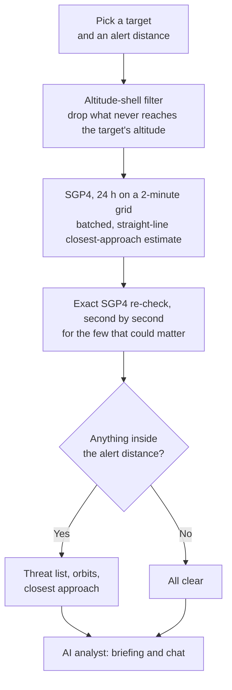
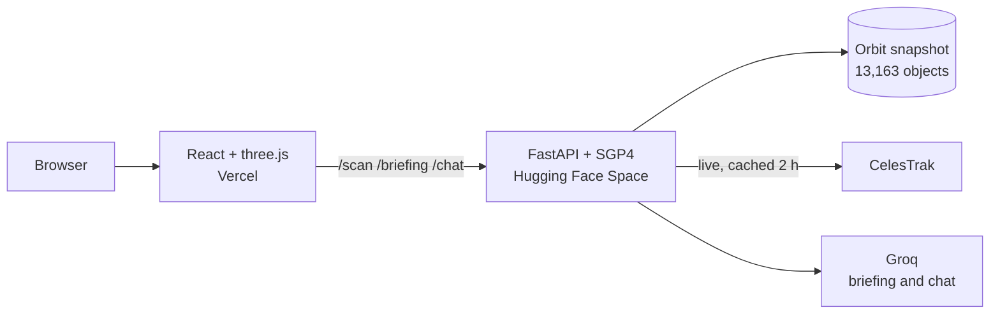

<!-- Automatically generated from README.md by .github/workflows/translate-readme.yml. Do not edit by hand. -->
<p align="center"><sub><a href="../../README.md">English</a> · <a href="README.ta.md">தமிழ்</a> · <a href="README.hi.md">हिन्दी</a> · <a href="README.te.md">తెలుగు</a> · <a href="README.ml.md">മലയാളം</a> · <a href="README.kn.md">ಕನ್ನಡ</a> · <a href="README.bn.md">বাংলা</a> · <b>Español</b> · <a href="README.fr.md">Français</a> · <a href="README.de.md">Deutsch</a> · <a href="README.pt-BR.md">Português</a> · <a href="README.ja.md">日本語</a> · <a href="README.zh-CN.md">简体中文</a> · <a href="README.ar.md">العربية</a></sub></p>

<p align="center">
  
</p>

<p align="center">
  <a href="https://cassandra-orbit.vercel.app"><b>Demo en vivo</b></a>
  &nbsp;·&nbsp;
  <a href="#how-it-works">Cómo funciona</a>
  &nbsp;·&nbsp;
  <a href="#run-it-yourself">Ejecutarlo tú mismo</a>
</p>

<p align="center">
  
  
  
  
  
</p>


Elige un satélite, pulsa **Scan** y descubre si algo en órbita se acerca a él en las próximas 24 horas. Cassandra Orbit compara más de 18 000 objetos rastreados (satélites en funcionamiento más más de 2 600 piezas de escombros conocidos) contra la ISS, Hubble, la estación Tiangong, un Starlink o cualquier objeto que busques, y muestra los pases cercanos en un globo 3D y los explica en lenguaje sencillo.

> Esta es una demostración de cribado basada en elementos orbitales públicos. Las distancias son estimaciones, **no** una probabilidad operativa de colisión, y los operadores reales utilizan datos mucho más precisos.

## Features

<p align="center">
  
</p>

* **Un escaneo con física real.** Cada objeto se proyecta 24 horas hacia adelante con SGP4, el modelo orbital estándar, y el objetivo se compara contra todos ellos.
* **Suficientemente rápido para sentirse en tiempo real.** Los objetos que nunca pueden alcanzar la altitud del objetivo se descartan primero, el resto se propaga en lotes, y solo los cercanos se vuelven a comprobar segundo a segundo. El escaneo de la ISS tarda unos segundos en lugar de los 17 originales.
* **No se pierden cruces rápidos.** Dos objetos que se encuentran de frente pueden acercarse a 10‑14 km/s, de modo que una cuadrícula de muestreo de un minuto puede saltarse el punto más cercano. La re‑comprobación lo detecta (el pase más cercano de la ISS en la instantánea empaquetada es de 6,8 km a 10,3 km/s).
* **Instantáneas u órbitas en vivo.** Una instantánea empaquetada de más de 18 000 objetos (satélites más escombros conocidos), actualizada cada día por una GitHub Action, siempre funciona; el interruptor Live extrae las órbitas de hoy de CelesTrak (almacenadas en caché durante dos horas, según lo permite CelesTrak).
* **Una vista 3D que puedes arrastrar y tocar.** Todo el catálogo como una nube de puntos, la órbita del objetivo y la órbita completa de cada amenaza como un anillo cerrado. Pasa el cursor sobre una órbita para ver de qué se trata, tócalo o haz clic para fijarlo (la lista de pases y la tabla hacen lo mismo).
* **Un analista IA.** Un informe en lenguaje sencillo para cada escaneo, un modo “explícalo simplemente” y un chat que solo conoce ese escaneo. Ve los números, nada más.
* **Una tarjeta de llamado cercano compartible.** Un toque convierte el escaneo en una imagen 4:5.

## How it works



The deployed system:



The first screen opens with a precomputed ISS scan bundled in `public/demo.json`, so the page is alive before the API wakes. The API exposes `/health`, `/targets`, `/objects` (search), `/cloud`, `/scan`, `/briefing` and `/chat`.

### A note on orbit data

TLEs go stale within days. The snapshot is refreshed daily, but a scan on it still starts from the snapshot's own date, not from today, and says so on screen. Use **Live** for today's orbits.

## Tech stack

| | |
|---|---|
| **Frontend** | React 18, TypeScript, Vite, three.js. Fonts: Michroma, Sora, Martian Mono (self-hosted). |
| **Backend** | FastAPI, NumPy, [`sgp4`](https://pypi.org/project/sgp4/) (vectorised `SatrecArray`), httpx. |
| **AI** | Groq (`openai/gpt-oss-120b`) through its REST API. A rule-based briefing is used when there is no key. |
| **Data** | [CelesTrak](https://celestrak.org) `active` group plus the Cosmos 2251, Iridium 33, Fengyun-1C and Cosmos 1408 debris groups, with a bundled snapshot in `backend/data/active.txt` and `backend/data/debris.txt`. Debris points are warm white on the globe and diamond-shaped on the timeline. |

## Run it yourself

```bash
git clone https://github.com/aristotile-dev/Space-Debris-Alert-Dashboard.git
cd Space-Debris-Alert-Dashboard
```

**Backend** (Python 3.11):

```bash
cd backend
pip install -r requirements.txt
# optional, for the AI analyst: set GROQ_API_KEY in your environment
uvicorn api:app --port 7861
```

**Frontend:**

```bash
npm install
echo "VITE_API_BASE_URL=http://localhost:7861" > .env.local
npm run dev
```

Rebuild the bundled first-screen data after changing the snapshot or the scan:

```bash
cd backend && python make_demo.py
```

## Project layout

```
Space-Debris-Alert-Dashboard
├── src/
│   ├── App.tsx        console: controls, status, briefing, table, chat drawer
│   ├── Globe.tsx      three.js scene: glass Earth, debris cloud, orbit tubes
│   ├── card.ts        the shareable close-call card (canvas to PNG)
│   ├── api.ts         typed API client
│   └── styles.css     the Y2K chrome-future design tokens and components
├── backend/
│   ├── core.py        catalogue, altitude filter, SGP4 scan, live cache
│   ├── api.py         FastAPI routes and rate limits
│   ├── llm.py         briefing and chat (Groq), rule-based fallback
│   ├── make_demo.py   writes public/demo.json
│   └── data/             orbit snapshots (active.txt, debris.txt)
├── public/demo.json   precomputed first screen
└── assets/            README screenshots
```

## Acknowledgements

Orbit data and years of public TLE service from Dr. T.S. Kelso and [CelesTrak](https://celestrak.org).

## License

MIT. See [LICENSE](../../LICENSE).
