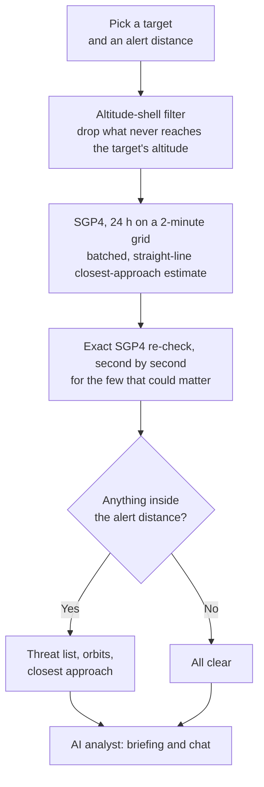
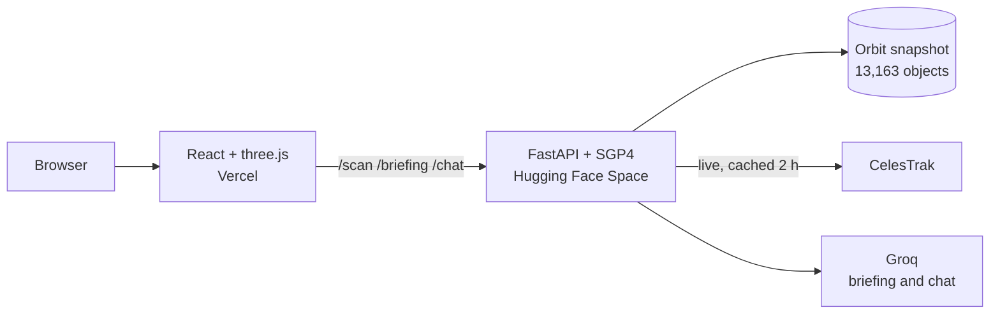

<!-- Automatically generated from README.md by .github/workflows/translate-readme.yml. Do not edit by hand. -->
<p align="center"><sub><a href="../../README.md">English</a> · <a href="README.ta.md">தமிழ்</a> · <a href="README.hi.md">हिन्दी</a> · <a href="README.te.md">తెలుగు</a> · <a href="README.ml.md">മലയാളം</a> · <a href="README.kn.md">ಕನ್ನಡ</a> · <a href="README.bn.md">বাংলা</a> · <a href="README.es.md">Español</a> · <b>Français</b> · <a href="README.de.md">Deutsch</a> · <a href="README.pt-BR.md">Português</a> · <a href="README.ja.md">日本語</a> · <a href="README.zh-CN.md">简体中文</a> · <a href="README.ar.md">العربية</a></sub></p>

<p align="center">
  
</p>

<p align="center">
  <a href="https://cassandra-orbit.vercel.app"><b>Démo en ligne</b></a>
  &nbsp;·&nbsp;
  <a href="#how-it-works">Comment ça fonctionne</a>
  &nbsp;·&nbsp;
  <a href="#run-it-yourself">Lancer vous‑même</a>
</p>

<p align="center">
  
  
  
  
  
</p>


Choisissez un satellite, cliquez sur **Scan**, et découvrez si quelque chose en orbite s’en approche au cours des prochaines 24 heures. Cassandra Orbit compare plus de 18 000 objets suivis (satellites en activité plus plus de 2 600 débris connus) à l’ISS, Hubble, la station Tiangong, un Starlink ou tout autre objet que vous recherchez, puis affiche les passages rapprochés sur un globe 3D et les explique en termes simples.

> Il s’agit d’une démonstration de dépistage basée sur des éléments orbitaux publics. Les distances sont des estimations, **pas** une probabilité de collision opérationnelle, et les opérateurs réels utilisent des données bien plus précises.

## Features

<p align="center">
  
</p>

* **Un scan basé sur une vraie physique.** Chaque objet est propagé 24 heures en avant avec SGP4, le modèle orbital standard, et la cible est comparée à tous ces objets.
* **Assez rapide pour sembler en temps réel.** Les objets qui ne peuvent jamais atteindre l’altitude de la cible sont éliminés en premier, le reste est propagé par lots, et seuls les passages rapprochés sont revérifiés seconde par seconde. Le scan de l’ISS ne prend que quelques secondes au lieu des 17 initiales.
* **Les passages rapides ne sont pas manqués.** Deux objets se rencontrant de front peuvent se rapprocher à 10‑14 km/s, de sorte qu’une grille d’échantillonnage d’une minute pourrait sauter le point le plus proche. La revérification le trouve (le passage le plus proche de l’ISS dans l’instantané fourni est à 6,8 km à 10,3 km/s).
* **Instantané ou orbites en direct.** Un instantané fourni de plus de 18 000 objets (satellites plus débris connus), rafraîchi chaque jour par une GitHub Action, fonctionne toujours ; le commutateur Live récupère les orbites du jour depuis CelesTrak (mise en cache pendant deux heures, comme le demande CelesTrak).
* **Une vue 3D que vous pouvez faire glisser et piquer.** Tout le catalogue sous forme de nuage de points, l’orbite de la cible et chaque menace affichées comme un anneau complet. Survolez une orbite pour voir de quoi il s’agit, cliquez ou tapez dessus pour l’épingler (la liste des passages et le tableau font de même).
* **Un analyste IA.** Un briefing en langage clair pour chaque scan, un mode « expliquer simplement », et un chat qui ne connaît que ce scan. Il voit les chiffres, rien d’autre.
* **Une carte de proximité partageable.** Un seul tap transforme le scan en une image au format 4 : 5.

## How it works



Le système déployé :



Le premier écran s’ouvre avec un scan ISS pré‑calculé fourni dans `public/demo.json`, de sorte que la page est fonctionnelle avant que l’API ne se réveille. L’API expose `/health`, `/targets`, `/objects` (recherche), `/cloud`, `/scan`, `/briefing` et `/chat`.

### A note on orbit data

Les TLE deviennent obsolètes en quelques jours. L’instantané est rafraîchi quotidiennement, mais un scan basé sur celui‑ci commence toujours à la date de l’instantané, pas à aujourd’hui, et l’indique à l’écran. Utilisez **Live** pour les orbites du jour.

## Tech stack

| | |
|---|---|
| **Frontend** | React 18, TypeScript, Vite, three.js. Polices : Michroma, Sora, Martian Mono (auto‑hébergées). |
| **Backend** | FastAPI, NumPy, [`sgp4`](https://pypi.org/project/sgp4/) (vectorised `SatrecArray`), httpx. |
| **AI** | Groq (`openai/gpt-oss-120b`) via son API REST. Un briefing basé sur des règles est utilisé lorsqu’aucune clé n’est disponible. |
| **Data** | Groupe `active` de [CelesTrak](https://celestrak.org) plus les groupes de débris Cosmos 2251, Iridium 33, Fengyun‑1C et Cosmos 1408, avec un instantané fourni dans `backend/data/active.txt` et `backend/data/debris.txt`. Les points de débris sont blancs chauds sur le globe et en forme de diamant sur la frise chronologique. |

## Run it yourself

```bash
git clone https://github.com/aristotile-dev/Space-Debris-Alert-Dashboard.git
cd Space-Debris-Alert-Dashboard
```

**Backend** (Python 3.11) :

```bash
cd backend
pip install -r requirements.txt
# optional, for the AI analyst: set GROQ_API_KEY in your environment
uvicorn api:app --port 7861
```

**Frontend** :

```bash
npm install
echo "VITE_API_BASE_URL=http://localhost:7861" > .env.local
npm run dev
```

Reconstruisez les données du premier écran fourni après avoir modifié l’instantané ou le scan :

```bash
cd backend && python make_demo.py
```

## Project layout

```
Space-Debris-Alert-Dashboard
├── src/
│   ├── App.tsx        console: controls, status, briefing, table, chat drawer
│   ├── Globe.tsx      three.js scene: glass Earth, debris cloud, orbit tubes
│   ├── card.ts        the shareable close-call card (canvas to PNG)
│   ├── api.ts         typed API client
│   └── styles.css     the Y2K chrome-future design tokens and components
├── backend/
│   ├── core.py        catalogue, altitude filter, SGP4 scan, live cache
│   ├── api.py         FastAPI routes and rate limits
│   ├── llm.py         briefing and chat (Groq), rule-based fallback
│   ├── make_demo.py   writes public/demo.json
│   └── data/             orbit snapshots (active.txt, debris.txt)
├── public/demo.json   precomputed first screen
└── assets/            README screenshots
```

## Acknowledgements

Données orbitales et années de service public de TLE grâce au Dr T.S. Kelso et à [CelesTrak](https://celestrak.org).

## License

MIT. Voir [LICENSE](../../LICENSE).
