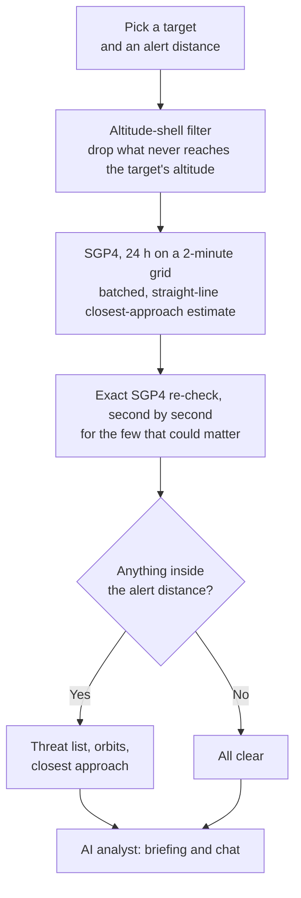
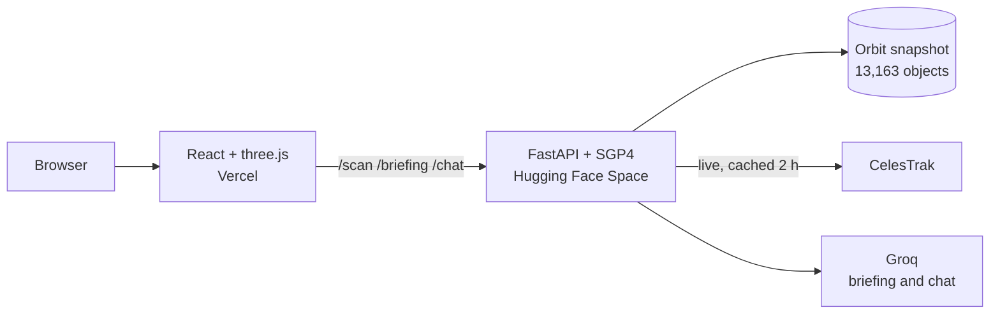

<!-- Automatically generated from README.md by .github/workflows/translate-readme.yml. Do not edit by hand. -->
<p align="center"><sub><a href="../../README.md">English</a> · <a href="README.ta.md">தமிழ்</a> · <b>हिन्दी</b> · <a href="README.te.md">తెలుగు</a> · <a href="README.ml.md">മലയാളം</a> · <a href="README.kn.md">ಕನ್ನಡ</a> · <a href="README.bn.md">বাংলা</a> · <a href="README.es.md">Español</a> · <a href="README.fr.md">Français</a> · <a href="README.de.md">Deutsch</a> · <a href="README.pt-BR.md">Português</a> · <a href="README.ja.md">日本語</a> · <a href="README.zh-CN.md">简体中文</a> · <a href="README.ar.md">العربية</a></sub></p>

<p align="center">
  
</p>

<p align="center">
  <a href="https://cassandra-orbit.vercel.app"><b>Live demo</b></a>
  &nbsp;·&nbsp;
  <a href="#how-it-works">How it works</a>
  &nbsp;·&nbsp;
  <a href="#run-it-yourself">Run it yourself</a>
</p>

<p align="center">
  
  
  
  
  
</p>


एक उपग्रह चुनें, **Scan** बटन दबाएँ, और पता लगाएँ कि अगले 24 घंटों में उसके कक्षा में कोई वस्तु उसके पास आती है या नहीं। Cassandra Orbit 18,000+ ट्रैक्ड वस्तुओं (संचालन में उपग्रह और 2,600+ ज्ञात मलबे) को ISS, Hubble, Tiangong स्टेशन, Starlink या आपके द्वारा खोजे गए किसी भी लक्ष्य के विरुद्ध जाँचता है, फिर निकटतम पास को 3D ग्लोब पर दिखाता है और उन्हें साधारण भाषा में समझाता है।

> यह एक स्क्रीनिंग डेमो है जो सार्वजनिक कक्षीय तत्वों पर आधारित है। दूरी अनुमानित हैं, **ऑपरेशनल टकराव संभावना** नहीं, और वास्तविक ऑपरेटर अधिक सटीक डेटा का उपयोग करते हैं।

## Features

<p align="center">
  
</p>

* **एक वास्तविक भौतिकी स्कैन।** प्रत्येक वस्तु को SGP4, मानक कक्षा मॉडल, के साथ 24 घंटे आगे बढ़ाया जाता है, और लक्ष्य की तुलना सभी वस्तुओं से की जाती है।  
* **रियल‑टाइम जैसा महसूस होने के लिए पर्याप्त तेज़।** उन वस्तुओं को पहले हटाया जाता है जो लक्ष्य की ऊँचाई तक कभी नहीं पहुँच सकतीं, बाकी को बैचों में प्रसारित किया जाता है, और केवल निकटतम को सेकंड‑दर‑सेकंड पुनः जाँच किया जाता है। ISS स्कैन कुछ सेकंड में पूरा हो जाता है, मूल 17 सेकंड की बजाय।  
* **तेज़ पारगमन नहीं छूटते।** दो वस्तुएँ सिर‑से‑सिर 10‑14 km/s की गति से मिलती हैं, इसलिए एक‑मिनट की सैंपलिंग ग्रिड सबसे निकट बिंदु को छोड़ सकती है। पुनः जाँच इसे पकड़ लेती है (बंडल्ड स्नैपशॉट में सबसे निकटतम ISS पास 6.8 km पर 10.3 km/s है)।  
* **स्नैपशॉट या लाइव कक्षाएँ।** 18,000+ वस्तुओं (उपग्रह + ज्ञात मलबा) का बंडल्ड स्नैपशॉट, जो हर दिन GitHub Action द्वारा रीफ़्रेश होता है; Live स्विच आज की कक्षाएँ CelesTrak से (दो घंटे के लिए कैश्ड, जैसा CelesTrak अनुरोध करता है) लेता है।  
* **एक 3D दृश्य जिसे आप खींच और छू सकते हैं।** पूरी सूची बिंदु‑क्लाउड के रूप में, लक्ष्य की कक्षा और प्रत्येक खतरे की पूरी कक्षा बंद रिंग के रूप में। कक्षा पर होवर करने से उसका नाम दिखता है, टैप या क्लिक करने से उसे पिन किया जाता है (पास सूची और तालिका भी यही करती है)।  
* **एक AI विश्लेषक।** प्रत्येक स्कैन के लिए साधारण‑भाषा ब्रीफ़िंग, “साधारण रूप से समझाएँ” मोड, और एक चैट जो केवल उस स्कैन को जानती है। यह संख्याएँ देखती है, कुछ नहीं।  
* **एक शेयर करने योग्य क्लोज‑कॉल कार्ड।** एक टैप से स्कैन को 4:5 इमेज में बदलता है।

## How it works



The deployed system:



पहला स्क्रीन `public/demo.json` में पूर्व‑गणना किया गया ISS स्कैन बंडल के साथ खुलता है, इसलिए पेज API के जागने से पहले ही सक्रिय रहता है। API `/health`, `/targets`, `/objects` (search), `/cloud`, `/scan`, `/briefing` और `/chat` को एक्सपोज़ करता है।

### A note on orbit data

TLEs कुछ दिनों में पुरानी हो जाती हैं। स्नैपशॉट रोज़ रीफ़्रेश होता है, लेकिन उस पर किया गया स्कैन अभी भी स्नैपशॉट की तिथि से शुरू होता है, आज की नहीं, और यह स्क्रीन पर दिखाता है। आज की कक्षाओं के लिए **Live** का उपयोग करें।

## Tech stack

| | |
|---|---|
| **Frontend** | React 18, TypeScript, Vite, three.js. Fonts: Michroma, Sora, Martian Mono (self-hosted). |
| **Backend** | FastAPI, NumPy, [`sgp4`](https://pypi.org/project/sgp4/) (vectorised `SatrecArray`), httpx. |
| **AI** | Groq (`openai/gpt-oss-120b`) through its REST API. A rule-based briefing is used when there is no key. |
| **Data** | [CelesTrak](https://celestrak.org) `active` group plus the Cosmos 2251, Iridium 33, Fengyun-1C and Cosmos 1408 debris groups, with a bundled snapshot in `backend/data/active.txt` and `backend/data/debris.txt`. Debris points are warm white on the globe and diamond-shaped on the timeline. |

## Run it yourself

```bash
git clone https://github.com/aristotile-dev/Space-Debris-Alert-Dashboard.git
cd Space-Debris-Alert-Dashboard
```

**Backend** (Python 3.11):

```bash
cd backend
pip install -r requirements.txt
# optional, for the AI analyst: set GROQ_API_KEY in your environment
uvicorn api:app --port 7861
```

**Frontend:**

```bash
npm install
echo "VITE_API_BASE_URL=http://localhost:7861" > .env.local
npm run dev
```

स्नैपशॉट या स्कैन बदलने के बाद बंडल्ड प्रथम‑स्क्रीन डेटा को पुनः बनाएँ:

```bash
cd backend && python make_demo.py
```

## Project layout

```
Space-Debris-Alert-Dashboard
├── src/
│   ├── App.tsx        console: controls, status, briefing, table, chat drawer
│   ├── Globe.tsx      three.js scene: glass Earth, debris cloud, orbit tubes
│   ├── card.ts        the shareable close-call card (canvas to PNG)
│   ├── api.ts         typed API client
│   └── styles.css     the Y2K chrome-future design tokens and components
├── backend/
│   ├── core.py        catalogue, altitude filter, SGP4 scan, live cache
│   ├── api.py         FastAPI routes and rate limits
│   ├── llm.py         briefing and chat (Groq), rule-based fallback
│   ├── make_demo.py   writes public/demo.json
│   └── data/             orbit snapshots (active.txt, debris.txt)
├── public/demo.json   precomputed first screen
└── assets/            README screenshots
```

## Acknowledgements

Orbit data and years of public TLE service from Dr. T.S. Kelso and [CelesTrak](https://celestrak.org).

## License

MIT. See [LICENSE](../../LICENSE).
