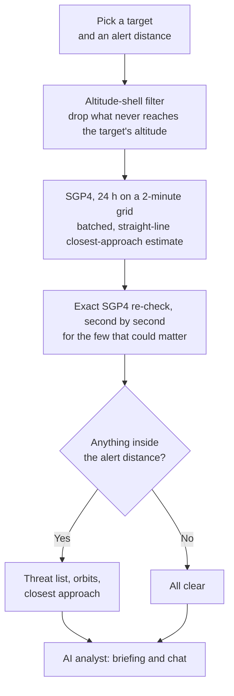
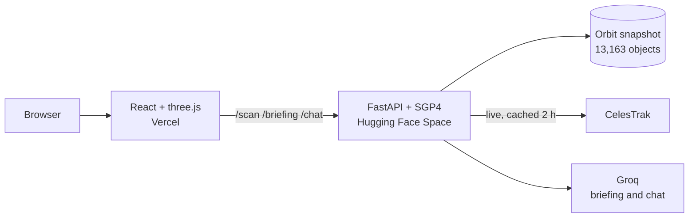

<!-- Automatically generated from README.md by .github/workflows/translate-readme.yml. Do not edit by hand. -->
<p align="center"><sub><a href="../../README.md">English</a> · <a href="README.ta.md">தமிழ்</a> · <a href="README.hi.md">हिन्दी</a> · <a href="README.te.md">తెలుగు</a> · <a href="README.ml.md">മലയാളം</a> · <a href="README.kn.md">ಕನ್ನಡ</a> · <a href="README.bn.md">বাংলা</a> · <a href="README.es.md">Español</a> · <a href="README.fr.md">Français</a> · <a href="README.de.md">Deutsch</a> · <a href="README.pt-BR.md">Português</a> · <b>日本語</b> · <a href="README.zh-CN.md">简体中文</a> · <a href="README.ar.md">العربية</a></sub></p>

<p align="center">
  
</p>

<p align="center">
  <a href="https://cassandra-orbit.vercel.app"><b>Live demo</b></a>
  &nbsp;·&nbsp;
  <a href="#how-it-works">How it works</a>
  &nbsp;·&nbsp;
  <a href="#run-it-yourself">Run it yourself</a>
</p>

<p align="center">
  
  
  
  
  
</p>


衛星を選択し **Scan** をクリックすると、次の 24 時間で軌道上に接近するものがあるかどうかが分かります。Cassandra Orbit は 18,000 件以上の追跡対象（稼働中の衛星と 2,600 件以上の既知デブリ）を ISS、ハッブル宇宙望遠鏡、天宮ステーション、Starlink、または検索した任意の対象と比較し、3D 地球儀上に接近通過を表示し、平易な言葉で説明します。

> これは公開されている軌道要素に基づくデモです。距離は概算であり、**運用上の衝突確率** ではなく、実際の運用者ははるかに精度の高いデータを使用します。

## Features

<p align="center">
  
</p>

* **実際の物理計算によるスキャン。** すべての対象を SGP4（標準軌道モデル）で 24 時間先まで予測し、対象とすべてを比較します。  
* **ライブ感覚の高速処理。** 目標高度に到達し得ない対象は最初に除外し、残りはバッチで伝搬、接近が疑われるものだけを秒単位で再チェックします。ISS のスキャンは元の 17 秒から数秒に短縮されます。  
* **高速交差も見逃さない。** 2 つの対象が 10〜14 km/s で正面衝突する場合、1 分間隔のサンプリングでは最接近点を通り過ぎる可能性がありますが、再チェックで検出します（バンドルされたスナップショットでの最も近い ISS 通過は 6.8 km、速度 10.3 km/s）。  
* **スナップショットまたはライブ軌道。** 18,000 件以上の対象（衛星＋既知デブリ）を日次で GitHub Action により更新するバンドルスナップショットを常に使用し、Live スイッチで CelesTrak から当日の軌道（2 時間キャッシュ）を取得します。  
* **ドラッグ＆クリック可能な 3D 表示。** カタログ全体を点群、対象の軌道とすべての脅威の軌道を閉じたリングとして表示。軌道にマウスオーバーで対象名が表示され、タップまたはクリックで固定でき、通過リストや表でも同様に操作できます。  
* **AI アナリスト。** 各スキャンに対する平易なブリーフィング、"explain it simply" モード、そしてスキャンに関する質問だけに答えるチャットを提供。数値は認識しますが、その他の情報は参照しません。  
* **共有可能な接近カード。** ワンタップでスキャン結果を 4:5 画像に変換します。

## How it works



The deployed system:



最初の画面は `public/demo.json` に事前計算された ISS スキャンをバンドルして表示するため、API が起動する前でもページが表示されます。API は `/health`、`/targets`、`/objects`（検索）、`/cloud`、`/scan`、`/briefing`、`/chat` を提供します。

### A note on orbit data

TLE は数日で古くなります。スナップショットは毎日更新されますが、スキャンはスナップショットの日時から開始され、当日のデータではありません。その旨は画面上に表示されます。最新の軌道が必要な場合は **Live** を使用してください。

## Tech stack

| | |
|---|---|
| **Frontend** | React 18, TypeScript, Vite, three.js. Fonts: Michroma, Sora, Martian Mono (self-hosted). |
| **Backend** | FastAPI, NumPy, [`sgp4`](https://pypi.org/project/sgp4/) (vectorised `SatrecArray`), httpx. |
| **AI** | Groq (`openai/gpt-oss-120b`) through its REST API. A rule-based briefing is used when there is no key. |
| **Data** | [CelesTrak](https://celestrak.org) `active` group plus the Cosmos 2251, Iridium 33, Fengyun-1C and Cosmos 1408 debris groups, with a bundled snapshot in `backend/data/active.txt` and `backend/data/debris.txt`. Debris points are warm white on the globe and diamond-shaped on the timeline. |

## Run it yourself

```bash
git clone https://github.com/aristotile-dev/Space-Debris-Alert-Dashboard.git
cd Space-Debris-Alert-Dashboard
```

**Backend** (Python 3.11):

```bash
cd backend
pip install -r requirements.txt
# optional, for the AI analyst: set GROQ_API_KEY in your environment
uvicorn api:app --port 7861
```

**Frontend:**

```bash
npm install
echo "VITE_API_BASE_URL=http://localhost:7861" > .env.local
npm run dev
```

スナップショットやスキャンを変更した後、バンドルされたファーストスクリーンデータを再構築します:

```bash
cd backend && python make_demo.py
```

## Project layout

```
Space-Debris-Alert-Dashboard
├── src/
│   ├── App.tsx        console: controls, status, briefing, table, chat drawer
│   ├── Globe.tsx      three.js scene: glass Earth, debris cloud, orbit tubes
│   ├── card.ts        the shareable close-call card (canvas to PNG)
│   ├── api.ts         typed API client
│   └── styles.css     the Y2K chrome-future design tokens and components
├── backend/
│   ├── core.py        catalogue, altitude filter, SGP4 scan, live cache
│   ├── api.py         FastAPI routes and rate limits
│   ├── llm.py         briefing and chat (Groq), rule-based fallback
│   ├── make_demo.py   writes public/demo.json
│   └── data/             orbit snapshots (active.txt, debris.txt)
├── public/demo.json   precomputed first screen
└── assets/            README screenshots
```

## Acknowledgements

Orbit data and years of public TLE service from Dr. T.S. Kelso and [CelesTrak](https://celestrak.org).

## License

MIT. See [LICENSE](../../LICENSE).
