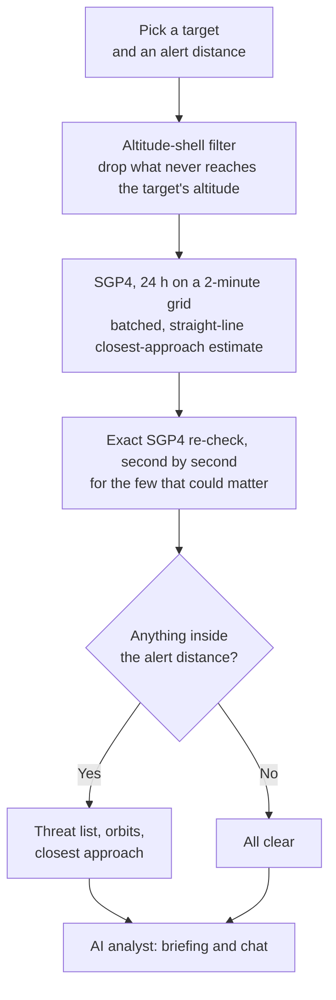
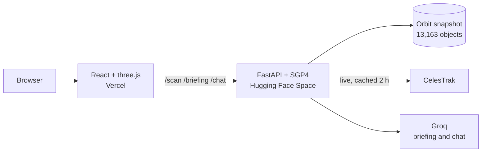

<!-- Automatically generated from README.md by .github/workflows/translate-readme.yml. Do not edit by hand. -->
<p align="center"><sub><a href="../../README.md">English</a> · <a href="README.ta.md">தமிழ்</a> · <a href="README.hi.md">हिन्दी</a> · <a href="README.te.md">తెలుగు</a> · <a href="README.ml.md">മലയാളം</a> · <b>ಕನ್ನಡ</b> · <a href="README.bn.md">বাংলা</a> · <a href="README.es.md">Español</a> · <a href="README.fr.md">Français</a> · <a href="README.de.md">Deutsch</a> · <a href="README.pt-BR.md">Português</a> · <a href="README.ja.md">日本語</a> · <a href="README.zh-CN.md">简体中文</a> · <a href="README.ar.md">العربية</a></sub></p>

<p align="center">
  
</p>

<p align="center">
  <a href="https://cassandra-orbit.vercel.app"><b>Live demo</b></a>
  &nbsp;·&nbsp;
  <a href="#how-it-works">How it works</a>
  &nbsp;·&nbsp;
  <a href="#run-it-yourself">Run it yourself</a>
</p>

<p align="center">
  
  
  
  
  
</p>


ಒಂದು ಉಪಗ್ರಹವನ್ನು ಆಯ್ಕೆ ಮಾಡಿ, **Scan** ಅನ್ನು ಒತ್ತಿ, ಮತ್ತು ಮುಂದಿನ 24 ಗಂಟೆಗಳಲ್ಲಿ ಅದರ ಕಕ್ಷೆಯಲ್ಲಿ ಏನಾದರೂ ಸಮೀಪಿಸುತ್ತಿದೆಯೇ ಎಂದು ತಿಳಿದುಕೊಳ್ಳಿ. Cassandra Orbit 18,000 ಕ್ಕೂ ಹೆಚ್ಚು ಟ್ರ್ಯಾಕ್ ಮಾಡಲಾದ ವಸ್ತುಗಳನ್ನು (ಕಾರ್ಯನಿರ್ವಹಿಸುವ ಉಪಗ್ರಹಗಳು ಮತ್ತು 2,600 ಕ್ಕೂ ಹೆಚ್ಚು ತಿಳಿದಿರುವ ಅವಶೇಷಗಳು) ISS, Hubble, Tiangong ಸ್ಟೇಷನ್, Starlink ಅಥವಾ ನೀವು ಹುಡುಕುವ ಯಾವುದೇ ವಸ್ತುವಿನ ವಿರುದ್ಧ ಪರಿಶೀಲಿಸಿ, ನಂತರ ಸಮೀಪದ ಹಾದಿಗಳನ್ನು 3D ಗೋಲಾಕಾರದಲ್ಲಿ ಪ್ರದರ್ಶಿಸಿ ಮತ್ತು ಅವುಗಳನ್ನು ಸರಳ ಭಾಷೆಯಲ್ಲಿ ವಿವರಿಸುತ್ತದೆ.

> ಇದು ಸಾರ್ವಜನಿಕ ಕಕ್ಷಾ ಅಂಶಗಳ ಮೇಲೆ ನಿರ್ಮಿಸಲಾದ ಒಂದು ಪ್ರದರ್ಶನಾ ಉದಾಹರಣೆ. ದೂರಗಳು ಅಂದಾಜುಗಳಾಗಿದ್ದು, **ಕಾರ್ಯಾಚರಣಾ ಘರ್ಷಣಾ ಸಾಧ್ಯತೆ** ಅಲ್ಲ, ಮತ್ತು ನೈಜ ಕಾರ್ಯಾಚರಣಾಕಾರರು ಇನ್ನಷ್ಟು ನಿಖರವಾದ ಡೇಟಾವನ್ನು ಬಳಸುತ್ತಾರೆ.

## Features

<p align="center">
  
</p>

* **ವಾಸ್ತವಿಕ ಭೌತಿಕ ಸ್ಕ್ಯಾನ್.** ಪ್ರತಿ ವಸ್ತುವನ್ನು SGP4, ಮಾನದಂಡ ಕಕ್ಷಾ ಮಾದರಿಯನ್ನು ಬಳಸಿಕೊಂಡು 24 ಗಂಟೆ ಮುಂದೆ ಸಾಗಿಸಲಾಗುತ್ತದೆ, ಮತ್ತು ಗುರಿಯನ್ನು ಅವುಗಳ ವಿರುದ್ಧ ಹೋಲಿಸಲಾಗುತ್ತದೆ.
* **ಜೀವಂತ ಅನುಭವಕ್ಕೆ ಸಾಕಷ್ಟು ವೇಗ.** ಗುರಿಯ ಎತ್ತರವನ್ನು ತಲುಪಲಾರದ ವಸ್ತುಗಳನ್ನು ಮೊದಲೇ ತೆಗೆದುಹಾಕಲಾಗುತ್ತದೆ, ಉಳಿದವುಗಳನ್ನು ಬ್ಯಾಚ್‌ಗಳಲ್ಲಿ ಪ್ರಚಲಿತಗೊಳಿಸಲಾಗುತ್ತದೆ, ಮತ್ತು ಸಮೀಪದವುಗಳನ್ನು ಪ್ರತಿ ಸೆಕೆಂಡ್‌ಗೂ ಮರುಪರಿಶೀಲಿಸಲಾಗುತ್ತದೆ. ISS ಸ್ಕ್ಯಾನ್ ಮೂಲ 17 ಸೆಕೆಂಡ್‌ಗಳ ಬದಲು ಕೆಲವು ಸೆಕೆಂಡ್‌ಗಳಲ್ಲಿ ಪೂರ್ಣಗೊಳ್ಳುತ್ತದೆ.
* **ವೇಗದ ದಾಟುಗಳನ್ನು ಮಿಸ್ ಮಾಡಿಕೊಳ್ಳುವುದಿಲ್ಲ.** ಎರಡು ವಸ್ತುಗಳು 10 ರಿಂದ 14 km/s ವೇಗದಲ್ಲಿ ಮುಖಾಮುಖಿಯಾಗಿ ಸಮೀಪಿಸುತ್ತವೆ, ಆದ್ದರಿಂದ ಒಂದು ನಿಮಿಷದ ಮಾದರಿ ಜಾಲವು ಅತ್ಯಂತ ಸಮೀಪದ ಬಿಂದುವನ್ನು ತಪ್ಪಿಸಬಹುದು. ಮರುಪರಿಶೀಲನೆ ಅದನ್ನು ಪತ್ತೆಹಚ್ಚುತ್ತದೆ (ಬಂಡಲ್‌ ಮಾಡಿದ ಸ್ನಾಪ್‌ಶಾಟ್‌ನಲ್ಲಿ ISS ನ ಅತ್ಯಂತ ಸಮೀಪದ ಪಾಸ್ 6.8 km, 10.3 km/s).
* **ಸ್ನಾಪ್‌ಶಾಟ್ ಅಥವಾ ಜೀವಂತ ಕಕ್ಷೆಗಳು.** 18,000 ಕ್ಕೂ ಹೆಚ್ಚು ವಸ್ತುಗಳ (ಉಪಗ್ರಹಗಳು ಮತ್ತು ತಿಳಿದಿರುವ ಅವಶೇಷಗಳು) ಬಂಡಲ್‌ ಮಾಡಿದ ಸ್ನಾಪ್‌ಶಾಟ್, ಪ್ರತಿ ದಿನ GitHub Action ಮೂಲಕ ನವೀಕರಿಸಲಾಗುತ್ತದೆ; Live ಸ್ವಿಚ್ CelesTrak ನಿಂದ (ಎರಡು ಗಂಟೆಗಳಿಗೆ ಕ್ಯಾಶ್ ಮಾಡಲ್ಪಟ್ಟ) ಇಂದಿನ ಕಕ್ಷೆಗಳನ್ನು ಪಡೆಯುತ್ತದೆ.
* **ನೀವು ಎಳೆಯಲು ಮತ್ತು ತೊಡಗಿಸಿಕೊಳ್ಳಲು ಸಾಧ್ಯವಾದ 3D ದೃಶ್ಯ.** ಸಂಪೂರ್ಣ ಕ್ಯಾಟಲಾಗ್ ಪಾಯಿಂಟ್ ಕ್ಲೌಡ್ ಆಗಿ, ಗುರಿಯ ಕಕ್ಷೆ ಮತ್ತು ಪ್ರತಿ ಬೆದರಿಕೆಯ ಪೂರ್ಣ ಕಕ್ಷೆ ಮುಚ್ಚಿದ ವಲಯವಾಗಿ. ಕಕ್ಷೆಯ ಮೇಲೆ ಹೋವರ್ ಮಾಡಿದರೆ ಅದು ಯಾವುದು ಎಂದು ಕಾಣುತ್ತದೆ, ಟ್ಯಾಪ್ ಅಥವಾ ಕ್ಲಿಕ್ ಮಾಡಿದರೆ ಪಿನ್ ಮಾಡುತ್ತದೆ (ಪಾಸ್ ಪಟ್ಟಿಯು ಮತ್ತು ಟೇಬಲ್ ಕೂಡ ಅದೇ ಕೆಲಸ ಮಾಡುತ್ತದೆ).
* **AI ವಿಶ್ಲೇಷಕ.** ಪ್ರತಿ ಸ್ಕ್ಯಾನ್‌ಗೆ ಸರಳ-ಭಾಷೆಯ ಸಂಕ್ಷಿಪ್ತ ವಿವರಣೆ, “ಸರಳವಾಗಿ ವಿವರಿಸಿ” ಮೋಡ್, ಮತ್ತು ಕೇವಲ ಆ ಸ್ಕ್ಯಾನ್‌ನ್ನು ತಿಳಿದಿರುವ ಚಾಟ್. ಇದು ಸಂಖ್ಯೆಗಳನ್ನೇ ನೋಡುತ್ತದೆ, ಇನ್ನೇನೂ ಇಲ್ಲ.
* **ಹಂಚಿಕೊಳ್ಳಬಹುದಾದ ಸಮೀಪ-ಕಾಲ್ ಕಾರ್ಡ್.** ಒಂದು ಟ್ಯಾಪ್‌ನಲ್ಲಿ ಸ್ಕ್ಯಾನ್ ಅನ್ನು 4:5 ಚಿತ್ರವಾಗಿ ಪರಿವರ್ತಿಸುತ್ತದೆ.

## How it works



The deployed system:



ಮೊದಲ ಪರದೆ `public/demo.json` ನಲ್ಲಿ ಪೂರ್ವಗಣಿತ ISS ಸ್ಕ್ಯಾನ್‌ನ್ನು ಹೊಂದಿದೆ, ಆದ್ದರಿಂದ API ಎಚ್ಚರವಾಗುವ ಮೊದಲು ಪುಟ ಜೀವಂತವಾಗಿರುತ್ತದೆ. API `/health`, `/targets`, `/objects` (ಶೋಧನೆ), `/cloud`, `/scan`, `/briefing` ಮತ್ತು `/chat` ಅನ್ನು ಒದಗಿಸುತ್ತದೆ.

### A note on orbit data

TLEಗಳು ಕೆಲವು ದಿನಗಳ ಒಳಗೆ ಹಳೆಯದಾಗುತ್ತವೆ. ಸ್ನಾಪ್‌ಶಾಟ್ ಪ್ರತಿ ದಿನ ನವೀಕರಿಸಲಾಗುತ್ತದೆ, ಆದರೆ ಅದರ ಮೇಲೆ ನಡೆಸುವ ಸ್ಕ್ಯಾನ್ ಇನ್ನೂ ಸ್ನಾಪ್‌ಶಾಟ್‌ನ ದಿನಾಂಕದಿಂದ ಪ್ರಾರಂಭವಾಗುತ್ತದೆ, ಇಂದಿನ ದಿನಾಂಕದಿಂದ ಅಲ್ಲ, ಮತ್ತು ಅದು ಪರದೆಯಲ್ಲಿ ಸೂಚಿಸಲಾಗುತ್ತದೆ. ಇಂದಿನ ಕಕ್ಷೆಗಳಿಗೆ **Live** ಅನ್ನು ಬಳಸಿ.

## Tech stack

| | |
|---|---|
| **Frontend** | React 18, TypeScript, Vite, three.js. Fonts: Michroma, Sora, Martian Mono (self-hosted). |
| **Backend** | FastAPI, NumPy, [`sgp4`](https://pypi.org/project/sgp4/) (vectorised `SatrecArray`), httpx. |
| **AI** | Groq (`openai/gpt-oss-120b`) through its REST API. A rule-based briefing is used when there is no key. |
| **Data** | [CelesTrak](https://celestrak.org) `active` group plus the Cosmos 2251, Iridium 33, Fengyun-1C and Cosmos 1408 debris groups, with a bundled snapshot in `backend/data/active.txt` and `backend/data/debris.txt`. Debris points are warm white on the globe and diamond-shaped on the timeline. |

## Run it yourself

```bash
git clone https://github.com/aristotile-dev/Space-Debris-Alert-Dashboard.git
cd Space-Debris-Alert-Dashboard
```

**Backend** (Python 3.11):

```bash
cd backend
pip install -r requirements.txt
# optional, for the AI analyst: set GROQ_API_KEY in your environment
uvicorn api:app --port 7861
```

**Frontend:**

```bash
npm install
echo "VITE_API_BASE_URL=http://localhost:7861" > .env.local
npm run dev
```

ಸ್ನಾಪ್‌ಶಾಟ್ ಅಥವಾ ಸ್ಕ್ಯಾನ್ ಅನ್ನು ಬದಲಿಸಿದ ನಂತರ ಬಂಡಲ್‌ ಮಾಡಿದ ಮೊದಲ-ಪರದೆ ಡೇಟಾವನ್ನು ಮರುನಿರ್ಮಿಸಿ:

```bash
cd backend && python make_demo.py
```

## Project layout

```
Space-Debris-Alert-Dashboard
├── src/
│   ├── App.tsx        console: controls, status, briefing, table, chat drawer
│   ├── Globe.tsx      three.js scene: glass Earth, debris cloud, orbit tubes
│   ├── card.ts        the shareable close-call card (canvas to PNG)
│   ├── api.ts         typed API client
│   └── styles.css     the Y2K chrome-future design tokens and components
├── backend/
│   ├── core.py        catalogue, altitude filter, SGP4 scan, live cache
│   ├── api.py         FastAPI routes and rate limits
│   ├── llm.py         briefing and chat (Groq), rule-based fallback
│   ├── make_demo.py   writes public/demo.json
│   └── data/             orbit snapshots (active.txt, debris.txt)
├── public/demo.json   precomputed first screen
└── assets/            README screenshots
```

## Acknowledgements

Orbit data and years of public TLE service from Dr. T.S. Kelso and [CelesTrak](https://celestrak.org).

## License

MIT. See [LICENSE](../../LICENSE).
