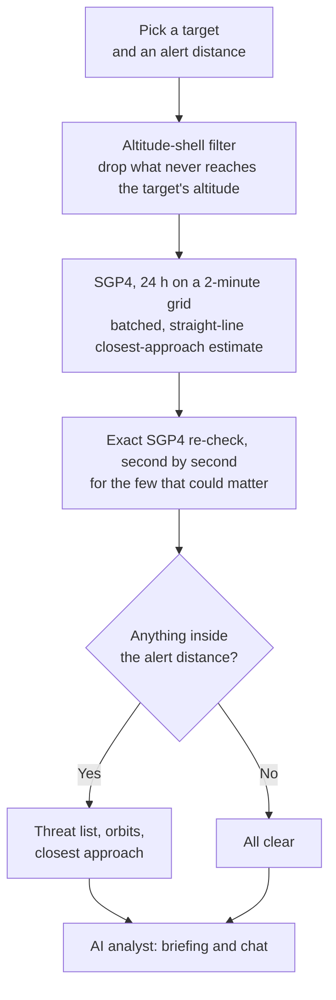
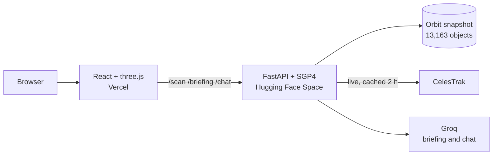

<!-- Automatically generated from README.md by .github/workflows/translate-readme.yml. Do not edit by hand. -->
<p align="center"><sub><a href="../../README.md">English</a> · <a href="README.ta.md">தமிழ்</a> · <a href="README.hi.md">हिन्दी</a> · <a href="README.te.md">తెలుగు</a> · <b>മലയാളം</b> · <a href="README.kn.md">ಕನ್ನಡ</a> · <a href="README.bn.md">বাংলা</a> · <a href="README.es.md">Español</a> · <a href="README.fr.md">Français</a> · <a href="README.de.md">Deutsch</a> · <a href="README.pt-BR.md">Português</a> · <a href="README.ja.md">日本語</a> · <a href="README.zh-CN.md">简体中文</a> · <a href="README.ar.md">العربية</a></sub></p>

<p align="center">
  
</p>

<p align="center">
  <a href="https://cassandra-orbit.vercel.app"><b>Live demo</b></a>
  &nbsp;·&nbsp;
  <a href="#how-it-works">How it works</a>
  &nbsp;·&nbsp;
  <a href="#run-it-yourself">Run it yourself</a>
</p>

<p align="center">
  
  
  
  
  
</p>


ഒരു സാറ്റലൈറ്റ് തിരഞ്ഞെടുക്കുക, **Scan** അമർത്തുക, അടുത്ത 24 മണിക്കൂറിൽ അതിന്റെ ചുറ്റുമുള്ള ഏതെങ്കിലും വസ്തു അതിനടുത്ത് വരുമോ എന്ന് കണ്ടെത്തുക. Cassandra Orbit 18,000‑ത്തിലധികം ട്രാക്ക് ചെയ്ത വസ്തുക്കൾ (പ്രവർത്തിക്കുന്ന സാറ്റലൈറ്റുകളും 2,600‑ത്തിലധികം അറിയപ്പെടുന്ന അവശിഷ്ടങ്ങളും) ISS, Hubble, Tiangong സ്റ്റേഷൻ, ഒരു Starlink, അല്ലെങ്കിൽ നിങ്ങൾ തിരയുന്ന ഏതെങ്കിലും വസ്തുവിനോടു താരതമ്യം ചെയ്യുകയും, 3D ഗ്ലോബിൽ അടുത്ത കടന്നുപോകലുകൾ പ്രദർശിപ്പിക്കുകയും, അവയെ ലളിതമായ ഭാഷയിൽ വിശദീകരിക്കുകയും ചെയ്യുന്നു.

> ഇത് പൊതുവായ കക്ഷി ഘടകങ്ങളിലേയ്ക്ക് അടിസ്ഥാനമാക്കിയുള്ള ഒരു സ്ക്രീനിംഗ് ഡെമോയാണ്. ദൂരം കണക്കുകൾ **ഓപ്പറേഷണൽ** ഇടപെടൽ സാധ്യതയല്ല, യഥാർത്ഥ ഓപ്പറേറ്റർമാർ കൂടുതൽ കൃത്യമായ ഡാറ്റ ഉപയോഗിക്കുന്നു.

## Features

<p align="center">
  
</p>

* **ഒരു യഥാർത്ഥ ഭൗതിക സ്കാൻ.** ഓരോ വസ്തുവും SGP4, സ്റ്റാൻഡേർഡ് ഓർബിറ്റ് മോഡൽ ഉപയോഗിച്ച് 24 മണിക്കൂർ മുന്നോട്ട് സിമുലേറ്റ് ചെയ്യപ്പെടുന്നു, ലക്ഷ്യവസ്തുവുമായി എല്ലാം താരതമ്യം ചെയ്യപ്പെടുന്നു.
* **ലൈവ് പോലെ അനുഭവിക്കാൻ മതിയായ വേഗം.** ലക്ഷ്യത്തിന്റെ ഉയരത്തിൽ എത്താൻ കഴിയാത്ത വസ്തുക്കൾ ആദ്യം ഒഴിവാക്കപ്പെടുന്നു, ശേഷിക്കുന്നവ ബാച്ചുകളായി പ്രചാരണം ചെയ്യപ്പെടുന്നു, അടുത്ത കടന്നുപോകലുകൾ മാത്രം സെക്കൻഡ്‑ബൈ‑സെക്കൻഡ് വീണ്ടും പരിശോധിക്കുന്നു. ISS സ്കാൻ ചില സെക്കൻഡുകൾ മാത്രമേ എടുക്കൂ, മുൻപ് 17 സെക്കൻഡ് ആയിരുന്നിടത്ത്.
* **വേഗത്തിലുള്ള കടന്നുപോകലുകൾ നഷ്ടമാകില്ല.** രണ്ട് വസ്തുക്കൾ 10‑ മുതൽ 14 km/s വരെ തലമുറയിൽ കൂടുമ്പോൾ, ഒരു മിനിറ്റ് സാമ്പ്ലിംഗ് ഗ്രിഡ് ഏറ്റവും അടുത്ത പോയിന്റ് ഒഴിവാക്കാൻ സാധ്യതയുണ്ട്. വീണ്ടും പരിശോധിക്കുന്നത് അത് കണ്ടെത്തുന്നു (ബണ്ടിൽ ചെയ്ത സ്നാപ്ഷോട്ടിലെ ഏറ്റവും അടുത്ത ISS കടന്നുപോകൽ 6.8 km, 10.3 km/s).
* **സ്നാപ്ഷോട്ട് അല്ലെങ്കിൽ ലൈവ് ഓർബിറ്റ്.** 18,000‑ത്തിലധികം വസ്തുക്കളുടെ (സാറ്റലൈറ്റുകളും അറിയപ്പെടുന്ന അവശിഷ്ടങ്ങളും) ബണ്ടിൽ ചെയ്ത സ്നാപ്ഷോട്ട്, ദിവസേന GitHub Action വഴി പുതുക്കപ്പെടുന്നു; Live സ്വിച്ച് CelesTrak‑ൽ നിന്ന് (2 മണിക്കൂർ കാഷ്) ഇന്നത്തെ ഓർബിറ്റുകൾ എടുത്തു കൊണ്ടുവരുന്നു.
* **നിങ്ങൾക്ക് ഡ്രാഗ് ചെയ്യാനും തട്ടാനും കഴിയുന്ന 3D കാഴ്ച.** മുഴുവൻ കാറ്റലോഗ് ഒരു പോയിന്റ് ക്ലൗഡായി, ലക്ഷ്യത്തിന്റെ ഓർബിറ്റ്, ഓരോ ഭീഷണിയുടെ മുഴുവൻ ഓർബിറ്റ് ഒരു അടച്ച റിങ്ങായി. ഒരു ഓർബിറ്റിൽ ഹോവർ ചെയ്യുമ്പോൾ അതിന്റെ പേര് കാണാം, തട്ടുകയോ ക്ലിക്ക് ചെയ്യുകയോ ചെയ്താൽ അത് പിൻ ചെയ്യപ്പെടും (പാസ് ലിസ്റ്റും പട്ടികയും അതേ പ്രവർത്തനം ചെയ്യുന്നു).
* **ഒരു AI വിശകലകൻ.** ഓരോ സ്കാനിനും ലളിതമായ ഭാഷയിൽ ഒരു ബ്രിഫിംഗ്, “സരളമായി വിശദീകരിക്കുക” മോഡ്, സ്കാനിനെക്കുറിച്ചുള്ള മാത്രം അറിവുള്ള ഒരു ചാറ്റ്. അത് സംഖ്യകൾ മാത്രം കാണുന്നു, മറ്റൊന്നും കാണില്ല.
* **പങ്കിടാവുന്ന ക്ലോസ്‑കോൾ കാർഡ്.** ഒരു തട്ടൽ സ്കാനിനെ 4:5 അനുപാതത്തിലുള്ള ചിത്രമായി മാറ്റുന്നു.

## How it works



The deployed system:



ആദ്യ സ്ക്രീൻ `public/demo.json`‑ൽ മുൻകൂട്ടി കണക്കാക്കിയ ISS സ്കാൻ ബണ്ടിൽ ചെയ്തതോടെ തുറക്കുന്നു, അതിനാൽ API ഉണരുന്നതിന് മുമ്പേ പേജ് സജീവമാകും. API `/health`, `/targets`, `/objects` (search), `/cloud`, `/scan`, `/briefing` and `/chat` എന്നിവ എക്സ്പോസ് ചെയ്യുന്നു.

### A note on orbit data

TLE‑കൾ ദിവസങ്ങളിലേയ്ക്ക് പഴയതാകുന്നു. സ്നാപ്ഷോട്ട് ദിവസേന പുതുക്കപ്പെടുന്നു, പക്ഷേ അതിൽ സ്കാൻ ചെയ്യുമ്പോൾ സ്നാപ്ഷോട്ടിന്റെ തീയതിയിൽ നിന്ന് ആരംഭിക്കും, ഇന്നത്തെ തീയതിയിൽ നിന്ന് അല്ല, കൂടാതെ സ്ക്രീനിൽ അതും കാണിക്കും. ഇന്നത്തെ ഓർബിറ്റുകൾക്കായി **Live** ഉപയോഗിക്കുക.

## Tech stack

| | |
|---|---|
| **Frontend** | React 18, TypeScript, Vite, three.js. Fonts: Michroma, Sora, Martian Mono (self-hosted). |
| **Backend** | FastAPI, NumPy, [`sgp4`](https://pypi.org/project/sgp4/) (vectorised `SatrecArray`), httpx. |
| **AI** | Groq (`openai/gpt-oss-120b`) through its REST API. A rule-based briefing is used when there is no key. |
| **Data** | [CelesTrak](https://celestrak.org) `active` group plus the Cosmos 2251, Iridium 33, Fengyun-1C and Cosmos 1408 debris groups, with a bundled snapshot in `backend/data/active.txt` and `backend/data/debris.txt`. Debris points are warm white on the globe and diamond-shaped on the timeline. |

## Run it yourself

```bash
git clone https://github.com/aristotile-dev/Space-Debris-Alert-Dashboard.git
cd Space-Debris-Alert-Dashboard
```

**Backend** (Python 3.11):

```bash
cd backend
pip install -r requirements.txt
# optional, for the AI analyst: set GROQ_API_KEY in your environment
uvicorn api:app --port 7861
```

**Frontend:**

```bash
npm install
echo "VITE_API_BASE_URL=http://localhost:7861" > .env.local
npm run dev
```

സ്നാപ്ഷോട്ട് അല്ലെങ്കിൽ സ്കാൻ മാറ്റിയ ശേഷം ബണ്ടിൽ ചെയ്ത ആദ്യ‑സ്ക്രീൻ ഡാറ്റ വീണ്ടും നിർമ്മിക്കാൻ:

```bash
cd backend && python make_demo.py
```

## Project layout

```
Space-Debris-Alert-Dashboard
├── src/
│   ├── App.tsx        console: controls, status, briefing, table, chat drawer
│   ├── Globe.tsx      three.js scene: glass Earth, debris cloud, orbit tubes
│   ├── card.ts        the shareable close-call card (canvas to PNG)
│   ├── api.ts         typed API client
│   └── styles.css     the Y2K chrome-future design tokens and components
├── backend/
│   ├── core.py        catalogue, altitude filter, SGP4 scan, live cache
│   ├── api.py         FastAPI routes and rate limits
│   ├── llm.py         briefing and chat (Groq), rule-based fallback
│   ├── make_demo.py   writes public/demo.json
│   └── data/             orbit snapshots (active.txt, debris.txt)
├── public/demo.json   precomputed first screen
└── assets/            README screenshots
```

## Acknowledgements

Orbit data and years of public TLE service from Dr. T.S. Kelso and [CelesTrak](https://celestrak.org).

## License

MIT. See [LICENSE](../../LICENSE).
