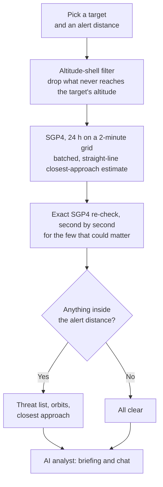
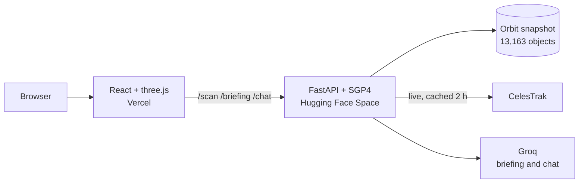

<!-- Automatically generated from README.md by .github/workflows/translate-readme.yml. Do not edit by hand. -->
<p align="center"><sub><a href="../../README.md">English</a> · <a href="README.ta.md">தமிழ்</a> · <a href="README.hi.md">हिन्दी</a> · <a href="README.te.md">తెలుగు</a> · <a href="README.ml.md">മലയാളം</a> · <a href="README.kn.md">ಕನ್ನಡ</a> · <a href="README.bn.md">বাংলা</a> · <a href="README.es.md">Español</a> · <a href="README.fr.md">Français</a> · <a href="README.de.md">Deutsch</a> · <b>Português</b> · <a href="README.ja.md">日本語</a> · <a href="README.zh-CN.md">简体中文</a> · <a href="README.ar.md">العربية</a></sub></p>

<p align="center">
  
</p>

<p align="center">
  <a href="https://cassandra-orbit.vercel.app"><b>Demo ao vivo</b></a>
  &nbsp;·&nbsp;
  <a href="#how-it-works">Como funciona</a>
  &nbsp;·&nbsp;
  <a href="#run-it-yourself">Execute você mesmo</a>
</p>

<p align="center">
  
  
  
  
  
</p>


Escolha um satélite, clique em **Scan** e descubra se algo em órbita se aproxima dele nas próximas 24 horas. Cassandra Orbit verifica mais de 18 000 objetos rastreados (satélites em operação mais mais de 2 600 peças de detritos conhecidos) contra a ISS, Hubble, a estação Tiangong, um Starlink ou qualquer alvo que você pesquisar, exibindo as aproximações em um globo 3D e explicando-as em linguagem simples.

> Esta é uma demonstração de triagem construída com elementos orbitais públicos. As distâncias são estimativas, **não** uma probabilidade operacional de colisão, e operadores reais utilizam dados muito mais precisos.

## Features

<p align="center">
  
</p>

* **Uma varredura com física real.** Cada objeto é propagado 24 horas à frente com SGP4, o modelo orbital padrão, e o alvo é comparado a todos eles.
* **Rápido o suficiente para parecer ao vivo.** Objetos que nunca podem alcançar a altitude do alvo são descartados primeiro, o restante é propagado em lotes, e apenas os próximos são reavaliados segundo a segundo. A varredura da ISS leva alguns segundos em vez dos 17 originais.
* **Passagens rápidas não são perdidas.** Dois objetos que se encontram de frente podem se aproximar a 10‑14 km/s, de modo que uma grade de amostragem de um minuto pode pular o ponto mais próximo. A reavaliação o encontra (a passagem mais próxima da ISS no instantâneo empacotado é 6,8 km a 10,3 km/s).
* **Instantâneo ou órbitas ao vivo.** Um instantâneo empacotado de mais de 18 000 objetos (satélites mais detritos conhecidos), atualizado diariamente por uma GitHub Action, sempre funciona; a opção Live obtém as órbitas de hoje do CelesTrak (em cache por duas horas, conforme a política do CelesTrak).
* **Visualização 3D interativa.** O catálogo completo como nuvem de pontos, a órbita do alvo e a órbita completa de cada ameaça como um anel fechado. Passe o mouse sobre uma órbita para ver quem é, clique ou toque para fixá‑la (a lista de passagens e a tabela fazem o mesmo).
* **Um analista de IA.** Um briefing em linguagem simples para cada varredura, modo “explique de forma simples” e um chat que conhece apenas aquela varredura. Ele vê os números, nada mais.
* **Um cartão de quase colisão compartilhável.** Um toque transforma a varredura em uma imagem 4:5.

## How it works



The deployed system:



The first screen opens with a precomputed ISS scan bundled in `public/demo.json`, so the page is alive before the API wakes. The API exposes `/health`, `/targets`, `/objects` (search), `/cloud`, `/scan`, `/briefing` and `/chat`.

### A note on orbit data

TLEs go stale within days. The snapshot is refreshed daily, but a scan on it still starts from the snapshot's own date, not from today, and says so on screen. Use **Live** for today's orbits.

## Tech stack

| | |
|---|---|
| **Frontend** | React 18, TypeScript, Vite, three.js. Fonts: Michroma, Sora, Martian Mono (self-hosted). |
| **Backend** | FastAPI, NumPy, [`sgp4`](https://pypi.org/project/sgp4/) (vectorised `SatrecArray`), httpx. |
| **AI** | Groq (`openai/gpt-oss-120b`) through its REST API. A rule-based briefing is used when there is no key. |
| **Data** | [CelesTrak](https://celestrak.org) `active` group plus the Cosmos 2251, Iridium 33, Fengyun-1C and Cosmos 1408 debris groups, with a bundled snapshot in `backend/data/active.txt` and `backend/data/debris.txt`. Debris points are warm white on the globe and diamond-shaped on the timeline. |

## Run it yourself

```bash
git clone https://github.com/aristotile-dev/Space-Debris-Alert-Dashboard.git
cd Space-Debris-Alert-Dashboard
```

**Backend** (Python 3.11):

```bash
cd backend
pip install -r requirements.txt
# optional, for the AI analyst: set GROQ_API_KEY in your environment
uvicorn api:app --port 7861
```

**Frontend:**

```bash
npm install
echo "VITE_API_BASE_URL=http://localhost:7861" > .env.local
npm run dev
```

Rebuild the bundled first-screen data after changing the snapshot or the scan:

```bash
cd backend && python make_demo.py
```

## Project layout

```
Space-Debris-Alert-Dashboard
├── src/
│   ├── App.tsx        console: controls, status, briefing, table, chat drawer
│   ├── Globe.tsx      three.js scene: glass Earth, debris cloud, orbit tubes
│   ├── card.ts        the shareable close-call card (canvas to PNG)
│   ├── api.ts         typed API client
│   └── styles.css     the Y2K chrome-future design tokens and components
├── backend/
│   ├── core.py        catalogue, altitude filter, SGP4 scan, live cache
│   ├── api.py         FastAPI routes and rate limits
│   ├── llm.py         briefing and chat (Groq), rule-based fallback
│   ├── make_demo.py   writes public/demo.json
│   └── data/             orbit snapshots (active.txt, debris.txt)
├── public/demo.json   precomputed first screen
└── assets/            README screenshots
```

## Acknowledgements

Orbit data and years of public TLE service from Dr. T.S. Kelso and [CelesTrak](https://celestrak.org).

## License

MIT. See [LICENSE](../../LICENSE).
