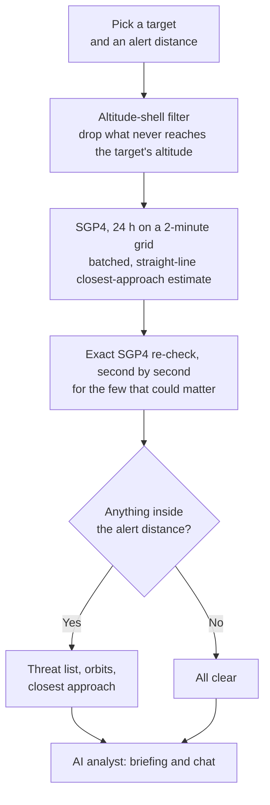
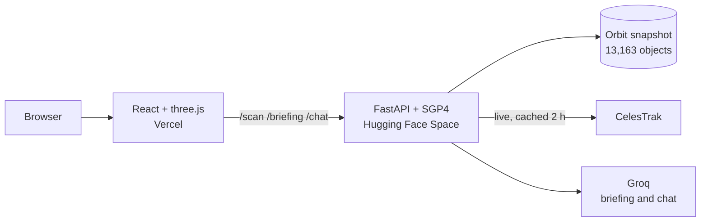

<!-- Automatically generated from README.md by .github/workflows/translate-readme.yml. Do not edit by hand. -->
<p align="center"><sub><a href="../../README.md">English</a> · <b>தமிழ்</b> · <a href="README.hi.md">हिन्दी</a> · <a href="README.te.md">తెలుగు</a> · <a href="README.ml.md">മലയാളം</a> · <a href="README.kn.md">ಕನ್ನಡ</a> · <a href="README.bn.md">বাংলা</a> · <a href="README.es.md">Español</a> · <a href="README.fr.md">Français</a> · <a href="README.de.md">Deutsch</a> · <a href="README.pt-BR.md">Português</a> · <a href="README.ja.md">日本語</a> · <a href="README.zh-CN.md">简体中文</a> · <a href="README.ar.md">العربية</a></sub></p>

<p align="center">
  
</p>

<p align="center">
  <a href="https://cassandra-orbit.vercel.app"><b>Live demo</b></a>
  &nbsp;·&nbsp;
  <a href="#how-it-works">How it works</a>
  &nbsp;·&nbsp;
  <a href="#run-it-yourself">Run it yourself</a>
</p>

<p align="center">
  
  
  
  
  
</p>


ஒரு செயற்கைக்கோளைத் தேர்ந்தெடுத்து **Scan** அழுத்தவும், அடுத்த 24 மணி நேரத்தில் அதற்கு அருகில் எதாவது பொருள் வருகிறதா என்பதை அறியவும். Cassandra Orbit 18,000+ கண்காணிக்கப்பட்ட பொருட்களை (செயலில் உள்ள செயற்கைக்கோள்கள் மற்றும் 2,600+ அறியப்பட்ட கழிவுகள்) ISS, Hubble, Tiangong நிலையம், Starlink அல்லது நீங்கள் தேடும் எந்தப் பொருளுடனும் ஒப்பிட்டு, 3D கோளில் அருகிலுள்ள கடந்து செல்லும் நிகழ்வுகளை காட்டி, அவற்றை எளிய மொழியில் விளக்குகிறது.

> இது பொது குணாதிசய கூறுகளின் அடிப்படையில் உருவாக்கப்பட்ட ஒரு முன்னோட்டம். தூரங்கள் மதிப்பீடுகள் மட்டுமே, **செயல்பாட்டு மோதல் சாத்தியமல்ல**, மற்றும் உண்மையான இயக்குநர்கள் மிகவும் துல்லியமான தரவுகளைப் பயன்படுத்துகிறார்கள்.

## Features

<p align="center">
  
</p>

* **உண்மையான இயற்பியல் ஸ்கேன்.** ஒவ்வொரு பொருளும் SGP4, நிலையான சுற்றுப்பாதை மாதிரி, மூலம் 24 மணி நேரம் முன்னோக்கி இயக்கப்படுகிறது, மற்றும் இலக்கு அனைத்து பொருட்களுடனும் ஒப்பிடப்படுகிறது.
* **நேரடி உணர்வை அளிக்கும் வேகம்.** இலக்கின் உயரத்தை எட்ட முடியாத பொருட்கள் முதலில் நீக்கப்படுகின்றன, மீதியவை தொகுதிகளில் பரவலாக கணக்கிடப்படுகின்றன, மற்றும் அருகிலுள்ளவை மட்டுமே ஒவ்வொரு விநாடியிலும் மீண்டும் சரிபார்க்கப்படுகின்றன. ISS ஸ்கேன் சில விநாடிகளில் முடிகிறது, முதலில் 17 விநாடிகள் எடுத்தது விட.
* **வேகமான கடத்தல்கள் தவறாமல் பிடிக்கப்படும்.** இரண்டு பொருட்கள் 10‑14 km/s வேகத்தில் தலைக்கு தலை மோதும், அதனால் ஒரு நிமிட மாதிரி கிரிட் அருகிலுள்ள புள்ளியை தவறவிடலாம். மீண்டும் சரிபார்ப்பது அதை கண்டுபிடிக்கிறது (பிணைக்கப்பட்ட ஸ்னாப்ஷாட்டில் ISS‑இன் அருகிலுள்ள கடத்தல் 6.8 km, 10.3 km/s).
* **ஸ்னாப்ஷாட் அல்லது நேரடி சுற்றுப்பாதைகள்.** 18,000+ பொருட்களின் (செயற்கைக்கோள்கள் + அறியப்பட்ட கழிவுகள்) பிணைக்கப்பட்ட ஸ்னாப்ஷாட், தினசரி GitHub Action மூலம் புதுப்பிக்கப்படுகிறது; Live முறை CelesTrak‑இலிருந்து (2 மணி நேரம் காச்ச்) இன்று உள்ள சுற்றுப்பாதைகளை பெறுகிறது.
* **நீங்கள் இழுத்து, தட்டிக்கூடிய 3D காட்சி.** முழு பட்டியலை புள்ளி மேகம் ஆக, இலக்கின் சுற்றுப்பாதை மற்றும் ஒவ்வொரு அச்சுறுத்தலின் முழு சுற்றுப்பாதை மூடிய வளையமாக காட்டுகிறது. ஒரு சுற்றுப்பாதையின் மீது மௌஸ் வைத்தால் அது யார் என்பதை காணலாம், தட்டவும் அல்லது கிளிக் செய்து பின் (பாஸ் பட்டியல் மற்றும் அட்டவணை அதே செயல்பாட்டை செய்கிறது).
* **AI பகுப்பாய்வாளர்.** ஒவ்வொரு ஸ்கேனுக்கும் எளிய மொழியில் ஒரு சுருக்கம், “எளிதாக விளக்கவும்” முறை, மற்றும் ஸ்கேனை மட்டுமே அறியும் ஒரு உரையாடல். இது எண்களை மட்டுமே பார்க்கிறது, மற்ற எதையும் இல்லை.
* **பகிரக்கூடிய அருகிலுள்ள அழைப்பு அட்டை.** ஒரு தட்டில் ஸ்கேனை 4:5 படமாக மாற்றுகிறது.

## How it works



The deployed system:



முதல் திரை `public/demo.json`‑இல் முன்கணிக்கப்பட்ட ISS ஸ்கேனைப் பயன்படுத்தி திறக்கப்படுகிறது, இதனால் API எழுந்து வருவதற்கு முன் பக்கம் செயல்படும். API `/health`, `/targets`, `/objects` (தேடல்), `/cloud`, `/scan`, `/briefing` மற்றும் `/chat` ஆகியவற்றை வழங்குகிறது.

### A note on orbit data

TLE‑கள் சில நாட்களில் பழையதாகும். ஸ்னாப்ஷாட் தினசரி புதுப்பிக்கப்படுகிறது, ஆனால் அதில் ஸ்கேன் செய்யும் போது ஸ்னாப்ஷாட் தேதி அடிப்படையாக இருக்கும், இன்று அல்ல, மற்றும் திரையில் அதைக் காட்டும். இன்று உள்ள சுற்றுப்பாதைகளுக்கு **Live**‑ஐ பயன்படுத்தவும்.

## Tech stack

| | |
|---|---|
| **Frontend** | React 18, TypeScript, Vite, three.js. Fonts: Michroma, Sora, Martian Mono (self-hosted). |
| **Backend** | FastAPI, NumPy, [`sgp4`](https://pypi.org/project/sgp4/) (vectorised `SatrecArray`), httpx. |
| **AI** | Groq (`openai/gpt-oss-120b`) through its REST API. A rule-based briefing is used when there is no key. |
| **Data** | [CelesTrak](https://celestrak.org) `active` group plus the Cosmos 2251, Iridium 33, Fengyun-1C and Cosmos 1408 debris groups, with a bundled snapshot in `backend/data/active.txt` and `backend/data/debris.txt`. Debris points are warm white on the globe and diamond-shaped on the timeline. |

## Run it yourself

```bash
git clone https://github.com/aristotile-dev/Space-Debris-Alert-Dashboard.git
cd Space-Debris-Alert-Dashboard
```

**Backend** (Python 3.11):

```bash
cd backend
pip install -r requirements.txt
# optional, for the AI analyst: set GROQ_API_KEY in your environment
uvicorn api:app --port 7861
```

**Frontend:**

```bash
npm install
echo "VITE_API_BASE_URL=http://localhost:7861" > .env.local
npm run dev
```

ஸ்னாப்ஷாட் அல்லது ஸ்கேன் மாற்றிய பிறகு பிணைக்கப்பட்ட முதல்‑திரை தரவை மீண்டும் கட்டமைக்க:

```bash
cd backend && python make_demo.py
```

## Project layout

```
Space-Debris-Alert-Dashboard
├── src/
│   ├── App.tsx        console: controls, status, briefing, table, chat drawer
│   ├── Globe.tsx      three.js scene: glass Earth, debris cloud, orbit tubes
│   ├── card.ts        the shareable close-call card (canvas to PNG)
│   ├── api.ts         typed API client
│   └── styles.css     the Y2K chrome-future design tokens and components
├── backend/
│   ├── core.py        catalogue, altitude filter, SGP4 scan, live cache
│   ├── api.py         FastAPI routes and rate limits
│   ├── llm.py         briefing and chat (Groq), rule-based fallback
│   ├── make_demo.py   writes public/demo.json
│   └── data/             orbit snapshots (active.txt, debris.txt)
├── public/demo.json   precomputed first screen
└── assets/            README screenshots
```

## Acknowledgements

Orbit data and years of public TLE service from Dr. T.S. Kelso and [CelesTrak](https://celestrak.org).

## License

MIT. See [LICENSE](../../LICENSE).
