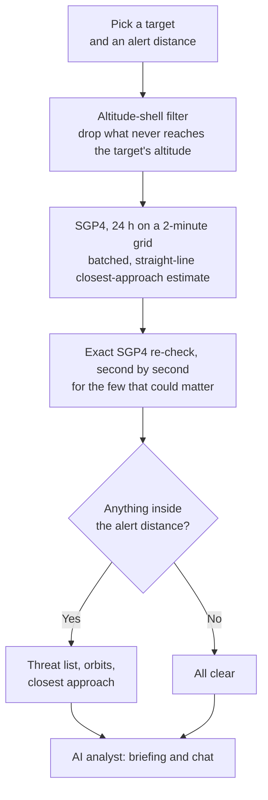
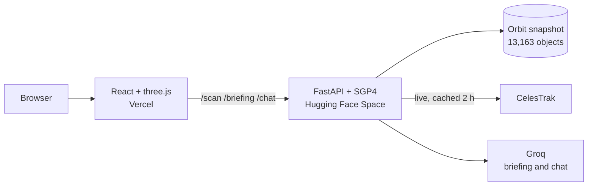

<!-- Automatically generated from README.md by .github/workflows/translate-readme.yml. Do not edit by hand. -->
<p align="center"><sub><a href="../../README.md">English</a> · <a href="README.ta.md">தமிழ்</a> · <a href="README.hi.md">हिन्दी</a> · <b>తెలుగు</b> · <a href="README.ml.md">മലയാളം</a> · <a href="README.kn.md">ಕನ್ನಡ</a> · <a href="README.bn.md">বাংলা</a> · <a href="README.es.md">Español</a> · <a href="README.fr.md">Français</a> · <a href="README.de.md">Deutsch</a> · <a href="README.pt-BR.md">Português</a> · <a href="README.ja.md">日本語</a> · <a href="README.zh-CN.md">简体中文</a> · <a href="README.ar.md">العربية</a></sub></p>

<p align="center">
  
</p>

<p align="center">
  <a href="https://cassandra-orbit.vercel.app"><b>Live demo</b></a>
  &nbsp;·&nbsp;
  <a href="#how-it-works">How it works</a>
  &nbsp;·&nbsp;
  <a href="#run-it-yourself">Run it yourself</a>
</p>

<p align="center">
  
  
  
  
  
</p>


ఒక ఉపగ్రహాన్ని ఎంచుకుని **Scan** బటన్‌ను నొక్కండి, తదుపరి 24 గంటల్లో ఆ ఉపగ్రహానికి సమీపంగా వచ్చే ఏదైనా వస్తువు ఉందో లేదో తెలుసుకోండి. Cassandra Orbit 18,000+ ట్రాక్ చేయబడిన వస్తువులను (కార్యనిర్వాహక ఉపగ్రహాలు మరియు 2,600+ తెలిసిన మలినాలు) ISS, Hubble, Tiangong స్టేషన్, Starlink లేదా మీరు శోధించే ఏదైనా లక్ష్యంతో పోల్చి, 3D గ్లోబ్‌పై సమీప పాస్‌లను చూపిస్తుంది మరియు వాటిని సులభమైన భాషలో వివరిస్తుంది.

> ఇది ప్రజా కక్ష్య అంశాలపై నిర్మించిన ఒక స్క్రీనింగ్ డెమో. దూరాలు అంచనాలు మాత్రమే, **ఆపరేషనల్** ఢీకొనుట సంభావ్యత కాదు, మరియు నిజమైన ఆపరేటర్లు మరింత ఖచ్చితమైన డేటాను ఉపయోగిస్తారు.

## Features

<p align="center">
  
</p>

* **నిజమైన భౌతిక శాస్త్ర స్కాన్.** ప్రతి వస్తువును SGP4, ప్రమాణ కక్ష్య మోడల్, ద్వారా 24 గంటల పాటు ముందుకు తీసుకెళ్తారు, మరియు లక్ష్యాన్ని వాటి అన్ని తో పోల్చుతారు.
* **లైవ్ అనిపించేంత వేగంగా.** లక్ష్య ఎత్తుకు చేరుకోలేని వస్తువులను ముందుగా తొలగిస్తారు, మిగిలినవాటిని బ్యాచ్‌లలో ప్రొపగేట్ చేస్తారు, మరియు సమీపమైనవాటిని మాత్రమే సెకన్‑సెకన్ పునఃపరిశీలిస్తారు. ISS స్కాన్ అసలు 17 సెకన్ల బదులు కొన్ని సెకన్లలో పూర్తవుతుంది.
* **వేగవంతమైన దాటింపులు మిస్ కావు.** రెండు వస్తువులు 10‑14 km/s వేగంతో తలమునకు తలమున కలిసినప్పుడు, ఒక‑నిమిషం నమూనా గ్రిడ్ అత్యంత సమీప బిందువును దాటవచ్చు. పునఃపరిశీలన దాన్ని కనుగొంటుంది (బండిల్ చేసిన స్నాప్షాట్‌లో ISS యొక్క అత్యంత సమీప పాస్ 6.8 km, 10.3 km/s వద్ద).
* **స్నాప్షాట్ లేదా లైవ్ కక్ష్యలు.** 18,000+ వస్తువుల (ఉపగ్రహాలు + తెలిసిన మలినాలు) బండిల్ చేసిన స్నాప్షాట్, రోజుకు ఒకసారి GitHub Action ద్వారా రిఫ్రెష్ చేయబడుతుంది; Live స్విచ్ CelesTrak నుండి (2 గంటల క్యాష్) నేటి కక్ష్యలను తీసుకుంటుంది.
* **డ్రాగ్‑అండ్‑పోక్ చేయగల 3D వీక్షణ.** మొత్తం క్యాటలాగ్ పాయింట్ క్లౌడ్‌గా, లక్ష్య కక్ష్య మరియు ప్రతి ముప్పు యొక్క పూర్తి కక్ష్య మూసివేసిన వలయంగా. ఒక కక్ష్యపై హోవర్ చేస్తే అది ఏమిటో చూడండి, ట్యాప్ లేదా క్లిక్ చేస్తే పిన్ చేయండి (పాస్ లిస్ట్ మరియు టేబుల్ కూడా అదే చేస్తాయి).
* **AI విశ్లేషకుడు.** ప్రతి స్కాన్‌కు సులభ‑భాషా బ్రీఫింగ్, “సరళంగా వివరణ” మోడ్, మరియు స్కాన్ మాత్రమే తెలుసుకునే చాట్. ఇది సంఖ్యలను మాత్రమే చూస్తుంది, మరేదీ కాదు.
* **షేర్ చేయగల సమీప‑కాల్డ్ కార్డ్.** ఒక ట్యాప్‌తో స్కాన్‌ను 4:5 చిత్రంగా మార్చుతుంది.

## How it works



The deployed system:



మొదటి స్క్రీన్ `public/demo.json` లో ముందుగా లెక్కించిన ISS స్కాన్‌తో తెరుచుకుంటుంది, అందువల్ల API మేల్కొనడానికి ముందు పేజీ లైవ్‌గా ఉంటుంది. API `/health`, `/targets`, `/objects` (search), `/cloud`, `/scan`, `/briefing` మరియు `/chat` ఎండ్‌పాయింట్లను అందిస్తుంది.

### A note on orbit data

TLEలు కొన్ని రోజుల్లో పాతబడతాయి. స్నాప్షాట్ రోజుకు ఒకసారి రిఫ్రెష్ చేయబడుతుంది, కానీ దానిపై స్కాన్ చేయడం still స్నాప్షాట్ తేదీ నుండి ప్రారంభమవుతుంది, నేటి తేదీ నుండి కాదు, మరియు స్క్రీన్‌పై అది చూపబడుతుంది. నేటి కక్ష్యల కోసం **Live** ను ఉపయోగించండి.

## Tech stack

| | |
|---|---|
| **Frontend** | React 18, TypeScript, Vite, three.js. Fonts: Michroma, Sora, Martian Mono (self-hosted). |
| **Backend** | FastAPI, NumPy, [`sgp4`](https://pypi.org/project/sgp4/) (vectorised `SatrecArray`), httpx. |
| **AI** | Groq (`openai/gpt-oss-120b`) through its REST API. A rule-based briefing is used when there is no key. |
| **Data** | [CelesTrak](https://celestrak.org) `active` group plus the Cosmos 2251, Iridium 33, Fengyun-1C and Cosmos 1408 debris groups, with a bundled snapshot in `backend/data/active.txt` and `backend/data/debris.txt`. Debris points are warm white on the globe and diamond-shaped on the timeline. |

## Run it yourself

```bash
git clone https://github.com/aristotile-dev/Space-Debris-Alert-Dashboard.git
cd Space-Debris-Alert-Dashboard
```

**Backend** (Python 3.11):

```bash
cd backend
pip install -r requirements.txt
# optional, for the AI analyst: set GROQ_API_KEY in your environment
uvicorn api:app --port 7861
```

**Frontend:**

```bash
npm install
echo "VITE_API_BASE_URL=http://localhost:7861" > .env.local
npm run dev
```

స్నాప్షాట్ లేదా స్కాన్ మార్చిన తర్వాత బండిల్ చేసిన మొదటి‑స్క్రీన్ డేటాను మళ్లీ నిర్మించండి:

```bash
cd backend && python make_demo.py
```

## Project layout

```
Space-Debris-Alert-Dashboard
├── src/
│   ├── App.tsx        console: controls, status, briefing, table, chat drawer
│   ├── Globe.tsx      three.js scene: glass Earth, debris cloud, orbit tubes
│   ├── card.ts        the shareable close-call card (canvas to PNG)
│   ├── api.ts         typed API client
│   └── styles.css     the Y2K chrome-future design tokens and components
├── backend/
│   ├── core.py        catalogue, altitude filter, SGP4 scan, live cache
│   ├── api.py         FastAPI routes and rate limits
│   ├── llm.py         briefing and chat (Groq), rule-based fallback
│   ├── make_demo.py   writes public/demo.json
│   └── data/             orbit snapshots (active.txt, debris.txt)
├── public/demo.json   precomputed first screen
└── assets/            README screenshots
```

## Acknowledgements

Orbit data and years of public TLE service from Dr. T.S. Kelso and [CelesTrak](https://celestrak.org).

## License

MIT. See [LICENSE](../../LICENSE).
