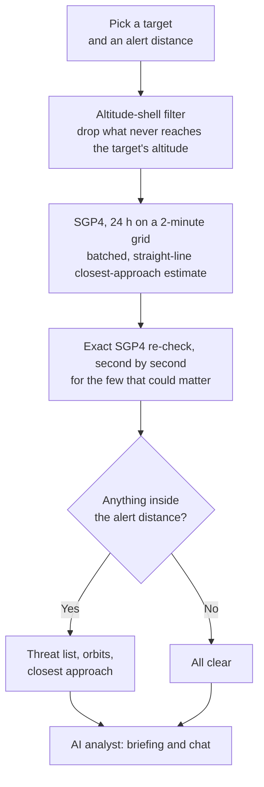
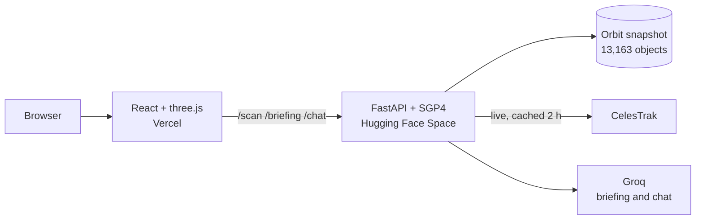

<!-- Automatically generated from README.md by .github/workflows/translate-readme.yml. Do not edit by hand. -->
<p align="center"><sub><a href="../../README.md">English</a> · <a href="README.ta.md">தமிழ்</a> · <a href="README.hi.md">हिन्दी</a> · <a href="README.te.md">తెలుగు</a> · <a href="README.ml.md">മലയാളം</a> · <a href="README.kn.md">ಕನ್ನಡ</a> · <a href="README.bn.md">বাংলা</a> · <a href="README.es.md">Español</a> · <a href="README.fr.md">Français</a> · <a href="README.de.md">Deutsch</a> · <a href="README.pt-BR.md">Português</a> · <a href="README.ja.md">日本語</a> · <b>简体中文</b> · <a href="README.ar.md">العربية</a></sub></p>

<p align="center">
  
</p>

<p align="center">
  <a href="https://cassandra-orbit.vercel.app"><b>Live demo</b></a>
  &nbsp;·&nbsp;
  <a href="#how-it-works">How it works</a>
  &nbsp;·&nbsp;
  <a href="#run-it-yourself">Run it yourself</a>
</p>

<p align="center">
  
  
  
  
  
</p>


选择一颗卫星，点击 **Scan**，即可了解在接下来的 24 小时内是否有任何轨道物体靠近它。Cassandra Orbit 会将 18,000 多个已跟踪对象（在轨卫星以及 2,600 多块已知碎片）与 ISS、哈勃望远镜、天宫空间站、Starlink 或您搜索的任意目标进行比对，并在 3D 地球仪上显示近距离掠过情况，并以通俗语言进行解释。

> 这是一款基于公开轨道要素的筛选演示。距离为估算值，**并非**实际碰撞概率，真实运营者使用的数 据要精确得多。

## Features

<p align="center">
  
</p>

* **真实的物理扫描。** 每个对象使用 SGP4（标准轨道模型）向前推演 24 小时，并将目标与所有对象进行比较。
* **足够快，感觉实时。** 先剔除永远达不到目标高度的对象，其余对象分批传播，仅对接近的对象进行逐秒复核。ISS 的扫描只需几秒，而非原来的 17 秒。
* **不会错过快速交叉。** 两个对象正面相遇时速度可达 10~14 km/s，若采用一分钟的采样网格可能会跳过最近点。复核过程能够捕捉到（在打包快照中最近的 ISS 掠过为 6.8 km，速度 10.3 km/s）。
* **快照或实时轨道。** 通过 GitHub Action 每日刷新一次的 18,000+ 对象（卫星加已知碎片）快照始终可用；Live 开关则从 CelesTrak 拉取当日轨道（缓存两小时，遵循 CelesTrak 的请求频率）。
* **可拖拽、可交互的 3D 视图。** 整个目录以点云形式呈现，目标轨道以及每个威胁的完整轨道以闭合环显示。将鼠标悬停在轨道上可查看名称，点击或轻触可固定（通过通过掠过列表和表格同样可实现）。
* **AI 分析师。** 为每次扫描提供通俗语言简报，“简明解释”模式，以及仅了解本次扫描内容的聊天功能。它只看到数字，别无他物。
* **可分享的近距离卡片。** 一次轻触即可将扫描结果生成 4:5 比例的图片。

## How it works



The deployed system:



The first screen opens with a precomputed ISS scan bundled in `public/demo.json`, so the page is alive before the API wakes. The API exposes `/health`, `/targets`, `/objects` (search), `/cloud`, `/scan`, `/briefing` and `/chat`.

### A note on orbit data

TLEs go stale within days. The snapshot is refreshed daily, but a scan on it still starts from the snapshot's own date, not from today, and says so on screen. Use **Live** for today's orbits.

## Tech stack

| | |
|---|---|
| **Frontend** | React 18, TypeScript, Vite, three.js. Fonts: Michroma, Sora, Martian Mono (self-hosted). |
| **Backend** | FastAPI, NumPy, [`sgp4`](https://pypi.org/project/sgp4/) (vectorised `SatrecArray`), httpx. |
| **AI** | Groq (`openai/gpt-oss-120b`) through its REST API. A rule-based briefing is used when there is no key. |
| **Data** | [CelesTrak](https://celestrak.org) `active` group plus the Cosmos 2251, Iridium 33, Fengyun-1C and Cosmos 1408 debris groups, with a bundled snapshot in `backend/data/active.txt` and `backend/data/debris.txt`. Debris points are warm white on the globe and diamond-shaped on the timeline. |

## Run it yourself

```bash
git clone https://github.com/aristotile-dev/Space-Debris-Alert-Dashboard.git
cd Space-Debris-Alert-Dashboard
```

**Backend** (Python 3.11):

```bash
cd backend
pip install -r requirements.txt
# optional, for the AI analyst: set GROQ_API_KEY in your environment
uvicorn api:app --port 7861
```

**Frontend:**

```bash
npm install
echo "VITE_API_BASE_URL=http://localhost:7861" > .env.local
npm run dev
```

Rebuild the bundled first-screen data after changing the snapshot or the scan:

```bash
cd backend && python make_demo.py
```

## Project layout

```
Space-Debris-Alert-Dashboard
├── src/
│   ├── App.tsx        console: controls, status, briefing, table, chat drawer
│   ├── Globe.tsx      three.js scene: glass Earth, debris cloud, orbit tubes
│   ├── card.ts        the shareable close-call card (canvas to PNG)
│   ├── api.ts         typed API client
│   └── styles.css     the Y2K chrome-future design tokens and components
├── backend/
│   ├── core.py        catalogue, altitude filter, SGP4 scan, live cache
│   ├── api.py         FastAPI routes and rate limits
│   ├── llm.py         briefing and chat (Groq), rule-based fallback
│   ├── make_demo.py   writes public/demo.json
│   └── data/             orbit snapshots (active.txt, debris.txt)
├── public/demo.json   precomputed first screen
└── assets/            README screenshots
```

## Acknowledgements

Orbit data and years of public TLE service from Dr. T.S. Kelso and [CelesTrak](https://celestrak.org).

## License

MIT. See [LICENSE](../../LICENSE).
